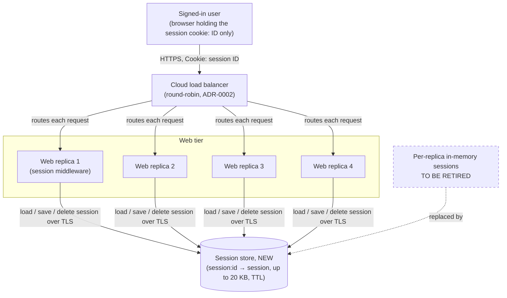
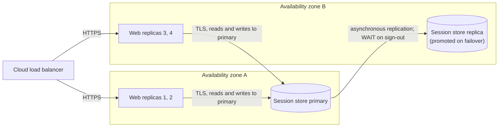

# Keeping users signed in across web replicas and deploys

**Status:** accepted, 2026-10-30 (recorded in the repository as ADR-0003)
**Decider:** Dana, team lead (autocratic, after consulting the web team)  ·  **Reviewers:** the security team (for F3 and the sign-out wording), the web team
**Relates to:** ADR-0002 "Run four stateless web replicas behind a round-robin balancer" (completes it; does not supersede it)
**Current working focus:** concluded

## Reversibility

Treated as a one-way door, with one reversible part. Where sessions live sets the security boundary for
sign-out: once session state is handed to the browser (the signed-cookie option), a copy of a cookie
cannot be called back, and that is the kind of choice the method treats as hard to undo. It also puts
a new stateful component on the path of every signed-in request. The session data itself is
reversible: sessions are short-lived, so moving them back to replica memory or to another store costs
one forced sign-in for everyone, which is what every deploy already costs today. The document therefore
uses the full method, kept compact.

## Context

The web tier runs four replicas behind the cloud load balancer, which routes round-robin. That shape
was chosen in ADR-0002 after a single web instance went down twice in March 2026 and took the site with
it (ADR-0002, `docs/adrs/0002-run-four-stateless-web-replicas.md`; *measured*, as recorded there).
ADR-0002 named the price in its consequences: "In-memory state is not shared between replicas."

Login sessions are part of that in-memory state. Each replica keeps the sessions it created in its own
process memory (requester, 2026-10-30; *assumed* in the sense that nobody has pointed at the session
middleware configuration yet; reading the web app's session setup would confirm it). Two things follow.
When the balancer sends a signed-in user's request to a replica that did not create the session, that
replica does not recognise the session cookie and treats the user as signed out. When the team deploys,
every replica is replaced, every replica's memory is discarded, and every signed-in user is signed out
at once.

How often the first case happens depends on whether the balancer spreads individual requests or whole
connections. With strict per-request round-robin over four replicas, three requests in four would land
on a replica without the session (3 ÷ 4; *estimated*), and the site would be unusable for signed-in
users. The requester describes intermittent sign-outs, which fits a balancer that pins a keep-alive
connection to one replica until the connection closes (*assumed*; the balancer's routing mode in its
configuration would confirm it). Either way the effect is the same kind of failure, and nothing below
depends on the exact rate.

Sessions hold up to 20 KB each (requester, 2026-10-30; *assumed*: nobody has measured it; logging the
serialized session size per request for one week, reporting p50, p99 and max, would confirm it). The
security team wants a sign-out to end the session immediately (requester relaying the security team,
2026-10-30). The team has discussed three options (sticky sessions, signed cookies, a shared store) and
has agreed on the shared store; Dana, the team lead, owns the call.

No traffic figures were supplied and none are in the repository: the number of signed-in users, live
sessions, requests per second and deploys per week are all unknown. Where the design needs them (store
sizing, latency budget) they are stated as *assumed* and the confirmation step measures them first.

### Current usage

| Role (what they do with the system) | What they do today | Through what | How often or how much (source) |
| --- | --- | --- | --- |
| Signed-in user (uses the site under their own account) | Signs in, browses, signs out | Browser, session cookie, balancer, one of four replicas | Unknown; no count supplied (*assumed*: the balancer's request metrics and a count of live sessions per replica would settle it) |
| Operator (deploys and runs the web tier) | Deploys new versions, replaces failed replicas | Deploy pipeline, cloud load balancer | Deploy frequency unknown (*assumed*; the deploy pipeline history would settle it). Each deploy signs out every signed-in user (requester; follows from in-memory sessions) |
| Security reviewer (sets the rules for session handling) | Requires sign-out to end a session | Review of the web tier's session handling | One stated rule: sign-out ends the session immediately (requester relaying security, 2026-10-30) |

### Problem

Signed-in users lose their session, and have to sign in again, whenever a request reaches a replica
other than the one that created the session, and every time the team deploys. The size of the gap is
not measured. The metric that would measure it is the count of requests that carry a well-formed
session cookie, before that session's expiry, which the receiving replica does not recognise; the web
tier does not emit it today (*assumed*). The confirmation step adds it.

### Goals

| ID | Goal | Who benefits | How we will know |
| --- | --- | --- | --- |
| G1 | A signed-in user stays signed in until they sign out or their session expires, whichever replica serves them | Signed-in user | Requests carrying an unexpired session cookie that the web tier does not recognise fall to near zero outside store incidents; support reports of unexpected sign-outs stop |
| G2 | Once a user signs out, nobody can carry on that session, including someone holding a copy of the cookie | Signed-in user; security reviewer | A replayed cookie is refused after sign-out, in a test run against every replica |
| G3 | Operators can deploy and replace replicas without that action signing users out | Operator | A deploy completes with zero sign-outs attributable to it on the metric in G1 |

### Stakeholders

| Role (what they do with the system) | What they need from this decision | Who speaks for them |
| --- | --- | --- |
| Signed-in user | Stay signed in across requests and deploys; have sign-out mean sign-out | No product owner was named; Dana, team lead (*assumed*) |
| Security reviewer | Sign-out ends the session for every copy of the cookie, before the user is told they are signed out | The security team (no named person supplied) |
| Operator | Deploy at any time without user-visible side effects; one more component to run, and only one | Dana and the web team |
| Maintainer (changes the web app's code) | A session layer whose format survives rolling deploys | The web team |
| Approver | A decision that can be defended and confirmed | Dana, team lead |
| Budget holder and on-call (negative stakeholders) | They pay for and get paged by a new stateful component | Dana (*assumed*; no budget owner named) |

### Constraints

| Constraint | Source (outside the organization, or a signed commitment) | What it excludes, and the clause |
| --- | --- | --- |
| Browsers are only required to store cookies of at least 4,096 bytes each, at least 50 cookies per domain | IETF RFC 6265, *HTTP State Management Mechanism*, section 6.1 "Limits" | Excludes holding a 20 KB session in one cookie. It does not exclude signed cookies outright: a 20 KB session needs at least five cookies (20,480 ÷ 4,096 = 5, before names, attributes and signatures), sent on every request to the domain |

No legal, contractual or budget constraint was supplied. The security team's sign-out rule comes from
inside the organization, so it is not a constraint: it enters the requirements as F3, with the security
reviewer as the role it serves.

### Prior decisions

| Prior decision | Who made it, when | Incumbent it implies | Cost to reverse |
| --- | --- | --- | --- |
| ADR-0001: record decisions as Nygard ADRs in `docs/adrs/` | The team, date not recorded | This decision is recorded there as ADR-0003 | Low: a documentation practice |
| ADR-0002: four web replicas behind round-robin routing | The team, after March 2026 | Round-robin routing with no affinity | Low for the routing setting (one balancer option); reversing the four replicas would undo ADR-0002's availability fix, which is out of proportion here |
| Sessions held in each replica's memory | Nobody recorded it; the web framework's default (*assumed*) | Baseline: do nothing | Low: it is the default being replaced |
| The team agreed to use a shared store | The web team, with Dana deciding, before 2026-10-30 | Shared server-side session store | Low today: nothing is built yet |

The team's agreement is a prior decision, not a constraint. It does not exclude sticky sessions or
signed cookies; this document puts all three, and the options nobody proposed, in the same table and
checks that the agreed option wins on the requirements rather than on the agreement.

### Assumptions and open questions

**Blocking:** none. Every open question below changes the size of the store, the product chosen for
it, or the confirmation targets. None changes where sessions live, which is what this document decides.

**Non-blocking:**

- Sessions are at most 20 KB (*assumed*, requester). Closed by a one-week log of serialized session
  size. If most of the 20 KB is cached application data rather than identity, trimming it is worth doing
  on its own merits (roadmap task T6); it would not reopen this decision, because sign-out still needs
  server-side state (see the signed-cookie rows).
- Live sessions and peak request rate are unknown (*assumed*). Store memory is about live sessions ×
  20 KB at worst: 50,000 live sessions would need about 1 GB (50,000 × 20 KB; *estimated* from an
  *assumed* count). Closed by counting live sessions per replica and reading the balancer's peak
  requests per second.
- The session cookie today carries an opaque session ID, not session data (*assumed*; the session
  middleware configuration would confirm it).
- Session idle and absolute timeouts stay as they are (*assumed*; this decision does not change them).
- "Immediately" is read as: from the moment the sign-out response is sent, every replica refuses the
  session. The security team is asked to confirm this wording; a stricter reading (also ending sessions
  on other devices, or an administrator ending a user's sessions) would add a per-user index to the
  store and does not change the option chosen.
- Dana's acceptance is taken from the requester's report that the team agreed and Dana owns the call.

### Out of scope

- How users authenticate (passwords, second factor, single sign-on).
- What application data belongs in a session; trimming it is a separate piece of work (T6).
- Ending a user's sessions on other devices, or by an administrator. Not requested.

## Requirements

Five items from the request were sorted. "Sessions hold up to 20 KB" is a non-functional requirement
with an *assumed* target (N1). "Security wants logout to end a session immediately" came in sounding
like a constraint; security is inside the organization, so it is a requirement (F3), and "immediately",
an absolute nobody can test, became "before the sign-out response is sent". Sticky sessions, signed
cookies and a shared store are design options and moved to the tradeoff table. "We agreed on the shared
store" is a prior decision. "Dana owns the call" names the decider.

### Functional

| ID | Goal | Requirement (the role, and what the system does for it) | Proof (the scenario, and how it is run) | Source |
| --- | --- | --- | --- | --- |
| F1 | G1 | A signed-in user whose next request reaches a different replica is served as the same signed-in user | Given a user signed in through replica A, when each of their next requests is pinned in turn to replicas B, C and D, then each response is the signed-in page for that user; run as an integration test in staging that addresses replicas directly | Context: sign-outs when the balancer changes replica |
| F2 | G1, G3 | A signed-in user stays signed in while operators deploy or replace replicas | Given 100 synthetic signed-in users making a request every 5 seconds, when a full rolling deploy replaces all four replicas, then no synthetic user is shown the sign-in page; run in staging on every release candidate | Context: every deploy signs everyone out |
| F3 | G2 | After a user signs out, the web tier treats any request carrying that session's cookie as signed out, on each replica, from the moment the sign-out response is sent | Given a user signed in and a copy of their session cookie, when the user signs out through replica A and the copy is replayed against replicas A, B, C and D immediately after the sign-out response arrives, then all four respond as signed out; run as an automated test in CI against staging, and repeated during the failover drill in N2 | Security reviewer, 2026-10-30 |

### Non-functional

| ID | Goal | Requirement (metric, target, condition) | Derived from | Proof (measurement) | Source |
| --- | --- | --- | --- | --- | --- |
| N1 | G1 | Largest serialized session the web tier stores and returns byte-identical: at least 20 KB, under normal load | 20 KB is the requester's stated maximum (*assumed*; measured first, see Confirmation) | Integration test writing and reading a 20 KB session through each replica; production histogram of session size | Context: session size |
| N2 | G1, G2 | When one session-store node fails: signed-in requests refused for lack of a reachable store are confined to a failover window of at most 30 seconds, and F3 holds for every sign-out acknowledged before the failure | ADR-0002 exists because one failed node took the site down twice in March 2026 (*measured*, ADR-0002); a session store with one node would reintroduce that single point of failure for every signed-in user. 30 seconds is *assumed* (no availability target is written down) and is confirmed with Dana after the first drill | Failover drill in staging: stop the store's primary under synthetic load, measure the window of refused signed-in requests from the replicas' logs, and run the F3 replay for sign-outs made just before the stop | ADR-0002 |
| N3 | G1 | Time the web tier adds to a signed-in request to load its session: p99 at or below 5 ms at the peak request rate | No current value: in-memory lookup is effectively free today. 5 ms is *assumed*, a small share of a page response; confirmed by measuring the first week | Timer around session load and save in each replica, reported per minute as p50 and p99 | Context: no traffic figures |

## Design

The design takes one decision per dimension: where session state lives, which store holds it, and how
the web tier uses it.

### Where session state lives

On the server, in one **session store** shared by all four replicas. The browser holds only the
**session cookie**: an opaque, random session ID of at least 128 bits, marked `HttpOnly`, `Secure` and
`SameSite=Lax`, carrying no session data. Any replica that receives the cookie loads the session from
the store (F1, F2). Ending a session is deleting it from the store, so every copy of the cookie stops
working at once (F3). Keeping data out of the cookie keeps every request inside RFC 6265's limits and
adds nothing to request size (constraint; N1). This restores the premise in ADR-0002's title: the
replicas hold no state a user depends on.

### Which store

A managed, Redis-compatible in-memory key-value service (Redis or Valkey offered by the cloud
provider), with one primary and one replica in a second availability zone and automatic failover
(N2). It is chosen over a relational table because it expires keys by itself (no cleanup job), serves a
single-key read in well under a millisecond on the same network (*assumed*; checked by N3's timer),
and keeps per-request session reads off any transactional database. The product is a recommendation;
Dana confirms it at implementation (T1), and any store that passes N1 to N3 satisfies this decision.
Access is restricted to the web tier's private network, with TLS and authentication between replicas
and store.

### How the web tier uses it

- **Key and expiry.** Key `session:<id>`, value the serialized session (up to 20 KB, N1), time-to-live
  equal to the idle timeout and refreshed on each signed-in request; the absolute expiry is stored in
  the value and checked on load (F1, F2).
- **Writes.** The session is written back only when the request changed it; otherwise only the
  time-to-live is refreshed, so a 20 KB value is not rewritten on every page view (N3).
- **Sign-out.** The replica deletes the key on the primary, waits for at least one store replica to
  acknowledge the delete (Redis `WAIT 1 <timeout>`), and only then sends the sign-out response (F3, N2).
  Without the wait, a primary that acknowledged a delete and failed before replicating it would let the
  promoted replica bring the session back.
- **Reads.** Session reads go to the primary only, never to a lagging replica, so a deleted session is
  not read back (F3).
- **Store unreachable.** The replica treats the request as signed out and shows the sign-in page
  (fail closed), and the error is alerted on. It does not fall back to local memory, because a
  sign-out handled by another replica would not reach that memory (F3 outranks G1 here; see Stakeholder
  conflicts).
- **Format across versions.** During a rolling deploy old and new code read the same sessions, so the
  session format carries a version field and new code reads the previous version (F2).

### Static view



*Figure 1. C4 container diagram of the web tier. Answers F1, F2, F3, N1.*

### Dynamic view

```mermaid
sequenceDiagram
    actor U as Signed-in user
    participant A as Web replica A
    participant B as Web replica B
    participant S as Session store (primary)
    participant R as Session store (replica)
    U->>A: sign in
    A->>S: SET session:id (TTL)
    A-->>U: Set-Cookie: session ID
    U->>B: next request, balancer chose B (F1)
    B->>S: GET session:id
    S-->>B: session
    B-->>U: signed-in page
    Note over A,B: rolling deploy replaces A and B; the store keeps the session (F2)
    U->>B: sign out
    B->>S: DEL session:id
    B->>S: WAIT 1 (replica acknowledged)
    S->>R: replicate delete
    B-->>U: signed out (F3)
    U->>A: replayed copy of the cookie
    A->>S: GET session:id
    S-->>A: not found
    A-->>U: sign-in page
```

*Figure 2. Sequence for "sign in on one replica, continue on another, sign out, replay the cookie".
Answers F1, F2, F3.*

### Deployment view



*Figure 3. Deployment diagram. Answers N2, N3. The zone placement of the web replicas is assumed; ADR-0002 does not record it.*

## Alternatives analysis (Tradeoff)

### Decision drivers

1. **F3, sign-out ends the session** (security reviewer). The one requirement no client-held design
   meets without adding server state.
2. **F2, deploys do not sign users out** (G3, operators). The one requirement affinity cannot meet,
   since a deploy discards the replica the user is pinned to.
3. **N2, no new single point of failure** (ADR-0002's reason for existing).
4. **Operational load**: a new stateful component to run, patch, monitor and pay for.
5. **Reversibility**: prefer the option whose data can be walked back (step 0).

### What every option shares

Every option keeps the four replicas behind the load balancer (ADR-0002, a prior decision; going back
to one instance would reverse ADR-0002's availability fix, which is out of proportion to this decision,
so it is recorded here rather than given a row). Every option keeps sign-in inside this web app; buying
that capability is the "hosted session service" row. Every option keeps a cookie as the browser's
credential; the alternative, a bearer token kept in browser storage that page scripts can read, was
considered and set aside because a cross-site scripting bug would hand the token to an attacker, which
works against G2, and it would need a server-side revocation list for F3 just as the hybrid row does.

| Alternative | Requirements (met / partial / missed, by ID) | Pros | Cons | Risk | Impact | Probability | Mitigation | Contingency |
| --- | --- | --- | --- | --- | --- | --- | --- | --- |
| **[Where sessions live] Shared server-side session store (the team's agreed option)** | met: F1, F2, F3, N1; partial: N2, N3 (both depend on the store's deployment and are *assumed* until the drill and the timer report) | One place to end a session, so F3 is a delete; replicas become stateless as ADR-0002 intended; no change to the balancer; data reversible at the cost of one forced sign-in | New stateful component on every signed-in request; monthly cost; session format must be compatible across a rolling deploy | Store outage signs every user out | High: all signed-in users | Low: replicated managed service with automatic failover (N2 design) | Primary plus cross-zone replica; failover drill before go-live and quarterly; alert on store errors | Fail closed (users sign in again); if outages recur, add a third node or move to a clustered store |
| | | | | A sign-out lost in failover lets a copied cookie live on | High: breaks F3 | Low: requires a primary failure between the delete and replication | `WAIT 1` before the sign-out response | Rotate the session ID on next sign-in; replay test in the drill catches regressions |
| | | | | Two parallel requests overwrite each other's session changes | Low: a lost cart or preference item (*assumed* session contents) | Medium: parallel requests from one page are common | Write back only changed sessions; keep frequently changed data out of the session (T6) | Per-field hash storage instead of one serialized value |
| **[Where sessions live] Sticky sessions (balancer affinity) on per-replica memory** | met: F1 while the replica lives, F3, N1, N3; missed: F2 (a deploy or replica loss discards the pinned replica's sessions); partial: N2 (a failed replica signs out its quarter of users) | At its best the smallest change: one balancer setting, no new component, no added latency, nothing new to pay for | Reverses ADR-0002's round-robin (low cost); uneven load when heavy users pile onto one replica; connection draining delays deploys and still ends sessions when the old replica stops | Users still signed out on every deploy, which is half of the problem | High: G1 and G3 remain unmet | High: certain on every deploy | Long connection draining | None that meets F2 without moving sessions off the replica, which is the shared store |
| **[Where sessions live] Signed cookies (session data held by the browser, signed by the server)** | met: F1, F2, N3 (no server state); partial: N1 (20 KB needs five or more cookies under RFC 6265 6.1, sent on every request); missed: F3 (a copied cookie stays valid until it expires), and with it the F3 clause of N2 |  At its best: no store to run or pay for, nothing to fail over, scales with the replicas | Every request, assets included, carries 20 KB or more of cookies; header size limits in the balancer or replicas may reject it (*assumed*; limits not checked); a key rotation signs everyone out | A stolen cookie works after sign-out | High: breaks G2 | High: certain by design, not a matter of chance | Short cookie lifetime (minutes) with silent renewal narrows the window | Add a server-side revocation list, which is the next row |
| **[Where sessions live] Small signed cookie plus a shared revocation list (nobody proposed it)** | met: F1, F2, F3; partial: N1 (only if the session is trimmed under 4 KB, T6), N2 and N3 (the revocation list is a shared store with the same failure modes) | Revocation list holds only signed-out IDs, so it is small; cookie readable without a store round trip | Needs the shared store anyway, plus key management and a trimmed session; two mechanisms where the store option has one | Revocation lookup skipped on a code path | High: breaks F3 | Medium: every request path must check it | Single middleware entry point | Fall back to the plain shared store |
| **[Where sessions live] Hosted identity or session service (buy; nobody proposed it)** | met: F3 for the identity token; partial: F1, F2 (the 20 KB of application data still needs a home on the server); N1 unaddressed | Sign-in, revocation and second factor maintained by a vendor | Rewrites the sign-in flow; adds an external dependency on every request; still needs a store for the application data in the session | Vendor outage blocks all sign-ins | High | Low to medium: vendor status history not checked (*assumed*) | Choose a vendor with a published availability commitment | Keep the current sign-in behind a flag |
| **Baseline: do nothing (per-replica memory, round-robin)** | met: F3 (a deleted session exists on one replica only), N1, N3; missed: F1, F2; partial: N2 (a replica failure signs out its users) | Zero work and zero cost; sign-out already ends the session | Users keep being signed out between requests and on every deploy | The problem persists and deploys get scheduled around users | High: G1 and G3 unmet | High: it is the measured situation, per the requester | None | None |
| **[Store] Managed Redis-compatible key-value service, primary plus cross-zone replica** | met: N1, N2 (with failover), N3 (*assumed* until measured) | Native per-key expiry; single-key reads in under a millisecond (*assumed*); `WAIT` gives a synchronous sign-out | A new service to operate and pay for; asynchronous replication needs the `WAIT` step | Memory runs out if live sessions × 20 KB exceeds the node | Medium: evictions sign users out | Low: sizing from the one-week count, with headroom | Size from measured live sessions; alert at 70% memory; no-eviction policy for session keys | Scale the node up; trim sessions (T6) |
| **[Store] Table in a relational database** | met: N1, F3 (transactional delete); partial: N3 (a read and often a write per request on a transactional database), N2 (as good as that database's failover) | No new technology if the team already runs one (*assumed*: this repository does not show a database) | Expiry needs a cleanup job; per-request load competes with application queries | Session traffic slows application queries | Medium | Medium: a read per signed-in request, write on change | Separate database or schema; index on expiry | Move sessions to the key-value service |

Each rejected option was taken at its best. Sticky sessions are the cheapest change and would remove
the between-requests sign-outs, but they cannot meet F2 because the session dies with its replica.
Signed cookies remove all server state and scale for free, but F3 asks the server to end a session the
browser holds, which requires server state; adding it produces the hybrid row, which keeps the store and
adds cookie limits on top. The baseline already meets F3, which is why "do nothing" is not dominated
on security, only on G1 and G3.

## The decision

**Keep login sessions in a shared server-side session store, with the browser holding only an opaque
session ID.** Recommended store: a managed Redis-compatible key-value service with a primary and a
cross-zone replica; Dana confirms the product at implementation (T1). Driver 1 (F3) removed signed
cookies, and the only way to rescue them, the hybrid, needs the same store. Driver 2 (F2) removed
sticky sessions. Among the options left, the shared store meets F1 to F3 and N1 with one mechanism, and
N2 and N3 are design properties of the store, confirmed by the drill and the timer. The cost is driver
4: a new component the team runs and pays for. The analysis supports the option the team had agreed.

**Decision style: autocratic.** Dana, team lead, owns the call after consulting the web team, who
agreed on the shared store before this document was written. The security team reviews F3 and the
reading of "immediately".

### Stakeholder conflicts

- **Signed-in users against the security reviewer, during a store outage.** Users (G1) would rather
  stay signed in on a replica's local copy; the security reviewer (F3) needs a sign-out on any replica to
  hold everywhere. The design fails closed: during an outage users are signed out. F3 overrides G1 here,
  by the security reviewer's requirement.
- **Budget holder and on-call against operators and users.** They take on a new component and its
  cost; F2 and F3 cannot both be met without it. Overridden by drivers 1 and 2; N2's drill and alerting
  are what they get in return.

### Consequences

- Deploys and replica replacements stop signing users out, so operators can deploy whenever a release
  is ready (G3).
- The replicas become stateless, which is what ADR-0002's title already claimed.
- Sign-out becomes a delete in one place; ending sessions on other devices, if ever requested, would be
  an index in the same store rather than a new mechanism.
- Every signed-in request now depends on the session store; its health is on the web tier's critical
  path and in the on-call rotation.
- The team now maintains the store's sizing, patching, failover drill, alerts and cost, and a
  versioned session format that old and new code both read during a rolling deploy.

### Residual risks

- A full store outage signs every user out and blocks sign-in until it recovers. Replication shortens
  it; it does not remove it.
- N2's 30-second window and N3's 5 ms are *assumed* targets; the first drill and the first week of
  timings may move them.
- The 20 KB figure is unmeasured. If real sessions are larger, or live sessions far more numerous than
  assumed, store cost grows linearly.
- Parallel requests can still overwrite each other's session changes, as they can within one replica
  today.

### Confirmation

- **Measured first** (the assumed inputs): one week of session size (p50, p99, max), live session count
  and peak requests per second, before the store is sized (T1).
- **Fitness function:** the F3 replay test (sign out on one replica, replay on all four) runs in CI
  against staging on every release; a failure blocks the release.
- **F2 gate:** the synthetic-user rolling-deploy test runs on every release candidate.
- **Metric:** requests with an unexpired session cookie that the store does not recognise, per minute,
  on the web tier's dashboard; expected to drop to near zero after cutover outside store incidents (G1).
- **N2:** failover drill before go-live, then quarterly; results recorded against the 30-second target.
- **N3:** session load timer p99, reviewed weekly for the first month.
- **Review date:** 2027-01-30. Revisit earlier if the store causes a user-visible incident, if session
  size passes 20 KB, or if the security team's reading of "immediately" turns out stricter.

## Launch strategy

1. **Build and prove in staging.** Provision the store (T1), switch the session middleware to it
   behind a configuration flag (T2), and run the F1, F2, F3, N1 tests and the N2 drill (T3, T4).
2. **Cut over in production with one deploy.** The deploy that turns the flag on discards the
   in-memory sessions exactly as every deploy does today; it is the last deploy that signs users out.
   Schedule it in a low-traffic hour.
3. **Retire the in-memory path** two weeks after cutover (T5). Until then, turning the flag off is the
   rollback, and it costs one forced sign-in.

## Tasks and roadmap

Estimates are *assumed* (no team velocity supplied).

| Task | Description | Estimate |
| --- | --- | --- |
| T1 | Measure session size, live sessions and peak requests for one week; size and provision the store (primary, cross-zone replica, TLS, authentication, private network); Dana confirms the product | 3d |
| T2 | Store-backed session middleware: opaque ID cookie, TTL refresh, write-on-change, versioned format, fail-closed handling, `WAIT 1` on sign-out, flag to switch back | 4d |
| T3 | Automated tests: F1 per-replica, F2 rolling deploy with synthetic users, F3 replay on four replicas, N1 20 KB round trip; wire F3 and F2 into CI as gates | 3d |
| T4 | Failover drill (N2), dashboards for the unrecognised-session metric and N3 timer, alerts on store errors and memory; on-call runbook for the store | 2d |
| T5 | Production cutover, then removal of the in-memory session path | 1d |
| T6 | Review what the 20 KB holds and move cached application data out of the session (roadmap; not required by this decision) | 2d |

## Glossary

| Term | Meaning |
| --- | --- |
| Session | The server's record that a browser is signed in as a given user, plus the data the web app keeps for that user between requests |
| Session cookie | The cookie the browser sends on each request; after this decision it carries only an opaque session ID |
| Session store | The shared key-value service holding every session, read and written by all four replicas |
| Replica | One of the four identical web app instances behind the load balancer (ADR-0002) |
| Sticky sessions (affinity) | A load balancer setting that sends a browser's requests to the same replica |
| Signed cookie | A cookie whose contents the server signs so it can detect tampering; the data lives in the browser |
| Sign-out | The user's action that ends their session; "logout" in the request |
| Fail closed | When the session store cannot be reached, treat the request as signed out |
| TTL | Time-to-live: the store deletes a key when it expires |

## Sources

- `docs/adrs/0001-record-architecture-decisions.md` (ADR practice and location).
- `docs/adrs/0002-run-four-stateless-web-replicas.md` (four replicas, round-robin, March 2026 outages,
  "in-memory state is not shared").
- The request, 2026-10-30: in-memory sessions, sign-outs on replica change and deploy, 20 KB maximum,
  security's sign-out rule, the three options, the team's agreement, Dana as owner.
- IETF RFC 6265, *HTTP State Management Mechanism*, section 6.1 "Limits".
- Redis documentation for the `WAIT` command (synchronous acknowledgement by replicas).

## Version history

| Version | Date | Author | Description |
| --- | --- | --- | --- |
| 1.0 | 2026-10-30 | Written for Dana, team lead | Decision recorded as accepted; filed as ADR-0003 |
