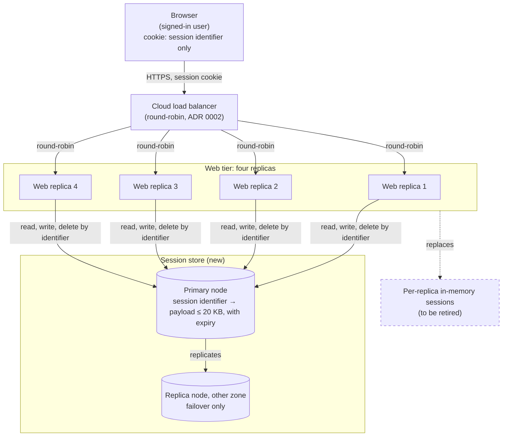

# Keeping users signed in across web replicas and deploys

**Status:** accepted (2026-10-30)
**Decider:** Dana, team lead (autocratic: Dana owns the call after consulting the team)  ·  **Reviewers:** the web team; the security function (for F3); the on-call rotation (for N3)
**Current working focus:** concluded
**Repository record:** `docs/adrs/0003-keep-sessions-in-a-shared-store.md` (Nygard format, status Accepted)

> **How this document was written.** The request arrived with the decision already agreed by the team
> ("go with the shared store") and asked for it to be put on record. The method was run in full anyway,
> so the record carries the reasons and not only the outcome. The analysis below reaches the same
> option the team chose, by a route the request did not state: the logout requirement (F3) on its own
> needs state that every replica can read at once, which is a shared store under any name, so signed
> cookies with a revocation list collapse into the same option. Assumptions are labeled inline; the
> repository holds no application code, so nothing about the web tier's framework, traffic or session
> contents could be verified from it.

## Reversibility

**One-way door on the session model; two-way door on the store engine.** Where a session lives
(server-side in a shared store, in each replica's memory, or in the browser) decides how logout works,
which is a security boundary, and it puts a new service on the path of every signed-in request. Moving
off it later means a second migration that signs every user out again and re-opens the logout question.
The choice of engine behind the shared store (a dedicated key-value store or a table in a database) is
hidden behind one session interface in the web application and can be swapped with a deploy, so it gets
less space below.

## Context

The site was a single web instance until March 2026, when that instance went down twice and took the
site with it (ADR 0002, `docs/adrs/0002-run-four-stateless-web-replicas.md`; *recorded*). ADR 0002
answered by running four web replicas behind the cloud load balancer with round-robin routing, and it
named the consequence in its own text: "In-memory state is not shared between replicas." Signed-in
sessions are exactly such state. Each replica keeps the sessions it created in its own memory (user
report; *assumed*: confirm by reading the session configuration of the web application), so a session
exists on one replica of four.

With round-robin across four replicas, a new connection lands on the replica that holds the user's
session one time in four, and three times in four on a replica that has never seen it (*estimated*:
uniform round-robin over 4 replicas, session on exactly one). Users are not signed out on every click,
which suggests the balancer routes per connection and browser keep-alive holds a user on one replica
until the connection closes (*assumed*: confirm in the load balancer's routing settings). Every deploy
restarts all four replicas, and a restart empties a replica's memory, so a deploy signs out every user
(user report; *assumed* as to scale: nobody has counted sign-ins after a deploy).

A session holds up to 20 KB (user report; *assumed*: a histogram of serialized session sizes from
production would confirm the maximum and show the typical size). The security function wants signing
out to end the session at once (user report). Today that works only by accident: the session is deleted
from the one replica that served the logout, which is the replica holding it only if the logout request
landed there.

### Current usage

| Role (what they do with the system) | What they do today | Through what | How often or how much (source) |
| --- | --- | --- | --- |
| Signed-in user | Signs in once, then browses and acts on pages that need their identity and the data stored in their session | Browser, session cookie, cloud load balancer, one of four web replicas | Sessions up to 20 KB (user report; *assumed*). Active session count unknown (*assumed*: the web application's session count metric, if exported, or a count of distinct session cookies in the balancer's access logs over a peak hour, would give it) |
| User signing out | Clicks "sign out" and expects the session to be over | Logout request to whichever replica the balancer picks | Rate unknown (*assumed*: the logout endpoint's request count in access logs) |
| Release engineer | Deploys the web tier, restarting each replica | Deployment pipeline | Deploy frequency unknown (*assumed*: the pipeline's run history). Every deploy signs out every user (user report) |
| On-call engineer | Keeps the web tier serving when a replica fails | Load balancer health checks, ADR 0002's four replicas | Two full-site outages in March 2026 before ADR 0002 (*recorded* in ADR 0002) |
| Security function | Reviews how sessions start and end | Policy and review | Requires that sign-out ends the session at once (user report) |

**The problem.** A signed-in user loses their session, and whatever it held, whenever the balancer
sends a new connection to another replica (three times in four on a new connection; *estimated*) and
every time the team deploys. A sign-out ends the session only when it reaches the one replica holding
it.

### Goals

| Goal | Who benefits | How we will know |
| --- | --- | --- |
| G1. Signed-in users keep working until they sign out or go idle, without being asked to sign in again | Signed-in users; release engineers, who stop paying for each deploy in user sign-outs | Sign-ins per active session fall, and the spike of sign-ins in the minutes after a deploy disappears (access logs, measured before and after cutover) |
| G2. A user who signs out is no longer signed in, wherever their next request lands | Users signing out; the security function | A replayed session cookie from a signed-out session is refused by every replica (security test) |
| G3. The site keeps serving signed-in users when one machine fails, as ADR 0002 set out to achieve | Signed-in users; on-call engineers | No full-site outage caused by a single machine failure (incident log) |

### Stakeholders

| Role (what they do with the system) | What they need from this decision | Who speaks for them |
| --- | --- | --- |
| Signed-in user | Stay signed in across replicas and deploys; keep what the session holds | Dana, team lead (no product owner named in the request; *assumed*) |
| User signing out | Sign-out takes effect on the next request | Security function |
| Security function | Sign-out ends the session at once, verifiably | Security function (name not given in the request) |
| Release engineer | Deploy at any time without signing users out | Dana, team lead |
| On-call engineer (negative stakeholder: gains a service to operate) | A failure of the new dependency is visible, bounded, and has a runbook | On-call rotation lead (not named; *assumed* to be Dana) |
| Approver | A decision on record with its reasons | Dana, team lead |

### Constraints

| Constraint | Source (outside the organization, or a signed commitment) | What it excludes, and the clause |
| --- | --- | --- |
| Browsers are only required to keep cookies of at least 4,096 bytes each (name, value and attributes together), at least 50 cookies per domain | RFC 6265, *HTTP State Management Mechanism*, section 6.1 (Limits) | It excludes carrying a 20 KB session in **one** cookie. It does not exclude splitting a session over several cookies; that cost is recorded in the signed-cookies row |

The logout requirement is not in this table: it comes from the organization's own security function,
so it is a requirement (F3) with that function as its source. OWASP ASVS 4.0.3 V3.3.1 ("logout and
expiration invalidate the session token") is the external reference that backs it, not a constraint
the organization has signed up to (*assumed*: no compliance commitment was mentioned).

### Prior decisions

| Prior decision | Who made it, when | Incumbent it implies | Cost to reverse |
| --- | --- | --- | --- |
| Four web replicas behind the cloud load balancer, round-robin routing (ADR 0002) | The team, recorded in ADR 0002 after the March 2026 outages | Stateless replicas with round-robin routing | Routing (round-robin to sticky): low, one balancer setting. Replica count (four to one): high, it brings back the single point of failure ADR 0002 removed |
| Go with the shared store | The team, agreed before this document; Dana owns the call | A shared session store | Low today: nothing is built. Medium after cutover: another migration signs everyone out again |
| Sessions hold up to 20 KB of data | Whoever designed the session contents (not named; *assumed* to be the web team) | Sessions sized as today | Medium: shrinking the session means moving its data to another store, page by page. Every option below inherits it except where a row says otherwise |

### Assumptions and open questions

**Blocking:** none. Each open question below changes how the shared store is built or sized, not
whether a shared store is chosen, because F3 rules out every option without server-side state that all
replicas read (see the tradeoff analysis). The status is therefore accepted.

**Non-blocking:**

| Question or assumption | Label | What closes it | Owner | By |
| --- | --- | --- | --- | --- |
| Maximum and typical serialized session size; the 20 KB maximum is the user's figure | *assumed* | A size histogram logged from production for one week | Web team | Before store sizing |
| Active sessions at the daily peak | *assumed* (unknown) | Session count from access logs at the peak hour | Web team | Before store sizing |
| Store memory needed: peak active sessions × 20 KB. At 10,000 sessions that is ≈200 MB; at 100,000, ≈2 GB | *estimated* (from the assumed 20 KB; arithmetic only) | The two measurements above | Web team | Before store sizing |
| The idle timeout and absolute session lifetime stay what the web application uses today | *assumed* | Read the session configuration and copy it into the store's expiry | Web team | Implementation |
| Whether the organization already runs a relational database the web tier uses, or a managed key-value store | *assumed* unknown | Inventory of the cloud account | Dana | Implementation (picks the engine, a two-way door) |
| Whether security also needs to end **all** of one user's sessions at once (forced sign-out after an account compromise) | Not requested; recorded so it is not lost | Ask the security function | Dana | Before the session interface is fixed |
| The balancer routes per connection, which is why users are not signed out on every click | *assumed* | Balancer routing settings | Web team | Any time; it changes the size of today's problem, not the decision |

### Out of scope

- **What a session should contain.** Shrinking the 20 KB is a design question for the pages that use
  it; this decision stores whatever the session holds today.
- **How users sign in** (passwords, single sign-on, multi-factor). Only where the session lives after
  sign-in is decided here.

## Requirements

> Reclassified from the request: "sticky sessions, signed cookies or a shared store" are options and
> moved to the tradeoff table. "We agreed to go with the shared store" is a prior decision by the team
> and has a row in the prior decisions table; the shared store is weighed here beside its alternatives
> rather than assumed. "Logout ends a session immediately" is kept as a requirement (F3) sourced from
> the security function, with "immediately" made testable as "the next request after the sign-out
> response". "Sessions hold up to 20 KB" is kept as a capacity requirement (N1), labeled assumed until
> measured. The four-replica, round-robin tier is a prior decision (ADR 0002), not a requirement. The
> availability requirement N3 was added by this document: it serves on-call engineers and G3, and it is
> what keeps the fix from undoing ADR 0002.

### Functional

| ID | Goal | Requirement (the role, and what the system does for it) | Proof (the scenario, and how it is run) | Source |
| --- | --- | --- | --- | --- |
| F1 | G1 | A signed-in user whose next request reaches a different replica stays signed in, with the same session data | Given a user signed in through replica A with a known session payload, when the next request is sent directly to replica B, then B serves it as that user and returns the same payload; repeated for every ordered pair of the four replicas. Integration test in CI against a four-replica test environment | Context: three in four new connections land on another replica (*estimated*) |
| F2 | G1 | A signed-in user stays signed in through a deploy of the web tier | Given 100 synthetic signed-in sessions, when a rolling deploy replaces all four replicas, then all 100 are still served as signed in, with their payloads intact. Run in staging on every release | Context: every deploy signs out every user (user report) |
| F3 | G2 | A user who signs out cannot use that session again: the first request after the sign-out response that carries the old session cookie is served as signed out, by every replica | Given a user signed in, when they sign out through replica A and the old cookie is replayed to each of the four replicas immediately after the sign-out response arrives, then all four serve the request as signed out. Security test in CI, plus the same replay in staging | Security function (user report); external reference OWASP ASVS 4.0.3 V3.3.1 |

### Non-functional

| ID | Goal | Requirement (metric, target, condition) | Derived from | Proof (measurement) | Source |
| --- | --- | --- | --- | --- | --- |
| N1 | G1 | Largest serialized session stored and read back intact: at least 20 KB, at the peak active-session count | 20 KB is the user's stated maximum (*assumed*); no headroom added until the histogram exists | A 20 KB session round-trip test in CI; the production size histogram, alerting on any session above 16 KB (80% of the target) | User report; Assumptions table |
| N2 | G1 | Added latency from reading and writing the session: p95 at or below 5 ms per request, at the peak request rate | *Assumed*: no current page latency figure was available. 5 ms is a placeholder small against a typical page response; measure today's p95 page latency first and restate the target as a share of it | Store client timing exported as a metric, read on the latency dashboard for the first month after cutover | Assumptions table |
| N3 | G3 | When any one machine fails (one web replica, or one node of the session store), signed-in users are served again within 60 s, and sessions written more than 1 s before the failure survive | ADR 0002 exists because one machine failing took the site down twice in March 2026 (*recorded*). The 60 s and 1 s figures are *assumed* (no on-call commitment was given) and are for the on-call lead to confirm | Failover drill in staging before cutover: kill one web replica, then the store's primary node, and time the recovery while the F1 test runs in a loop. Repeated each quarter | ADR 0002; on-call engineer role |

## Design

Every replica stops keeping sessions in its own memory and reads and writes them in one shared session
store. The browser holds only an opaque session identifier.

### Session model

The session cookie carries a random session identifier of 128 bits from a cryptographically secure
generator, and nothing else (well above the 64 bits of entropy OWASP ASVS 4.0.3 V3.2.2 asks for). The
cookie is marked `HttpOnly`, `Secure` and `SameSite=Lax`. Its size is well under the RFC 6265 limit, so
the constraint stops mattering. The session payload of up to 20 KB lives in the store under that
identifier (F1, F2, N1). The identifier is regenerated at sign-in, as today (*assumed*: confirm in the
web application's sign-in handler).

### Shared session store

One session store that all four replicas reach over the private network (F1, F2). Each entry expires on
its own after the current idle timeout, renewed on each request that touches the session (*assumed*
timeout unchanged from today). Sign-out deletes the entry before the sign-out response is sent (F3).

**Engine.** A managed, in-memory key-value store with per-key expiry, from the cloud provider already in
use, with one primary and one replica in another availability zone and automatic failover (N2, N3). A
key-value lookup by identifier is the only access pattern, and per-key expiry removes the need for a
cleanup job. A table in a relational database the team already runs is the alternative, weighed in the
tradeoff table; the engine sits behind one session interface in the web application, so this choice is
a two-way door.

**Consistency.** Every session read and write goes to the store's primary; the store's replica is used
only for failover. Reading from a lagging replica could serve a session that a sign-out had just
deleted, which would break F3.

**Failure behaviour.** If the store cannot be reached, the web application treats the request as signed
out and serves a sign-in page or a 503 for pages that require identity. It does not fall back to local
memory: a local fallback would recreate sessions that only one replica knows (F1) and that a sign-out on
another replica cannot end (F3). Store unavailability is alerted on (N3).

**Prior decisions.** Round-robin routing from ADR 0002 stays exactly as it is; this design is what makes
ADR 0002's "stateless replicas" true for sessions. If ADR 0002 is ever reversed to sticky routing, this
design still works.

### Static view



*Figure 1. C4 container diagram of the target state. Answers F1, F2, F3, N1, N3.*

### Dynamic view

```mermaid
sequenceDiagram
    actor U as Signed-in user
    participant LB as Cloud load balancer
    participant A as Web replica 1
    participant B as Web replica 3
    participant S as Session store (primary)
    U->>LB: sign in
    LB->>A: POST /sign-in
    A->>S: write new identifier → payload, with expiry
    A-->>U: Set-Cookie: session identifier
    U->>LB: next page, on a new connection
    LB->>B: GET /page (cookie)
    B->>S: read by identifier (F1, N2)
    S-->>B: payload
    B-->>U: page as the signed-in user
    Note over A,B: a rolling deploy restarts every replica; the store keeps the sessions (F2)
    U->>LB: sign out
    LB->>A: POST /sign-out (cookie)
    A->>S: delete identifier (F3)
    A-->>U: signed out
    U->>LB: replay of the old cookie
    LB->>B: GET /page (old cookie)
    B->>S: read by identifier
    S-->>B: not found
    B-->>U: served as signed out (F3)
```

*Figure 2. Sequence for "sign in, move replica, survive a deploy, sign out", container level. Answers
F1, F2, F3, N2.*

### Migration

Cutover is one deploy. Sessions held in replica memory at that moment are not copied: the cutover deploy
signs users out once, which is what every deploy does today, and every deploy after it does not. A
dual-read period (store first, local memory as fallback) was considered and rejected: it would keep F3
broken for the length of the window and add code that exists only to be deleted.

## Alternatives analysis (Tradeoff)

### Decision drivers

1. **F3**, signing out ends the session on the next request at any replica. The security function's
   requirement; it acts as a veto.
2. **F2** and **F1**, users stay signed in across deploys and replicas. This is the problem the decision
   exists to fix.
3. **N3**, the fix must not bring back the single-machine outages ADR 0002 removed.
4. **N1**, a 20 KB session, together with the RFC 6265 cookie limit.
5. **Operational load**: a new service for a small team to run and be paged for.
6. **Reversibility**: the session model is the one-way part (step 0), so evidence matters most there.

### What every option shares

Every option keeps the four replicas behind the cloud load balancer (ADR 0002, a prior decision whose
alternative, a single instance, has its own row), keeps the session contents at up to 20 KB (a prior
decision; shrinking them is out of scope, and the signed-cookies row records that a smaller session
would cure its size problem but not its F3 problem), and keeps some session cookie in the browser (no
option avoids it; only what the cookie carries differs). Options nobody proposed are in the table:
do nothing, going back to one instance, replicating sessions between replicas, signed cookies with a
revocation list, a database table as the store, and buying a hosted identity provider.

| Alternative | Requirements (met / partial / missed, by ID) | Pros | Cons | Risk | Impact | Probability | Mitigation | Contingency |
| --- | --- | --- | --- | --- | --- | --- | --- | --- |
| **[Session model] Shared session store, managed in-memory key-value engine (chosen; the team's prior decision)** | met: F1, F2, F3, N1; met by design, to be measured: N2, N3 | Any replica serves any request; deploys stop signing users out; sign-out is one delete; per-key expiry needs no cleanup job; keeps ADR 0002 unchanged | A new managed service to pay for and operate; a network round trip on every signed-in request; the store becomes a dependency of every deploy and of the site's availability | The store is unreachable and every signed-in user is served as signed out | High: every signed-in user at once | Low: managed service with a replica in another zone and automatic failover (provider's design; *assumed* until the N3 drill) | Primary plus cross-zone replica with automatic failover; alert on store errors and latency; N3 drill before cutover | Fail closed (sign-in page or 503) per the Design; scale or replace the node; runbook task below |
| | | | | The store fills up and starts evicting sessions, signing users out at random | Medium: affected users sign in again | Low to medium: peak session count is unknown (*assumed*) | Size the store from the measured peak × 20 KB with 2× headroom; eviction set to refuse writes rather than evict live sessions; memory alert at 70% | Scale the node up (minutes, managed service) |
| **[Store engine] Table in a relational database the team already runs (if one exists; *assumed* unknown)** | met: F1, F2, F3, N1; partial: N2 (a database write on every request that renews expiry; not measured); N3 depends on that database's failover | No new service if the database exists; transactional delete makes F3 simple; the team may already operate it | One write per signed-in request to renew expiry, on a database also serving other work; expiry needs a cleanup job; 20 KB rows churn the table | Session writes slow the database other features depend on | Medium to high, depending on what else the database serves | Unknown until the request rate is measured; recorded as a gap | Renew expiry at most once a minute per session; separate table with its own vacuum schedule | Move to the key-value engine behind the same session interface (two-way door) |
| **[Session model] Sticky sessions: balancer affinity cookie, plus connection draining on deploy (the smallest change; changes ADR 0002's routing)** | met: F3 (the session lives on the one replica every request reaches), N1, N2 (no added round trip); partial: F1 (holds only while that replica lives); missed: F2 (a restart empties the replica's memory; draining waits for in-flight requests, not for sessions that last hours), N3 (a failed replica signs out its users, about a quarter of them; *estimated*, one of four) | One balancer setting, no new service, no added latency, nothing to migrate; at its best it removes most of today's sign-outs between deploys | Deploys still sign out every user, replica by replica; uneven load when long sessions pile onto one replica; reverses ADR 0002's round-robin (low cost: a setting) | Users are still signed out on every deploy, which is half the problem | High: the problem remains | High: it follows from the mechanism | None within the option | Add a shared store later, which is this decision deferred |
| **[Session model] Signed cookies: the whole session in the browser, signed by the server** | met: F1, F2, N3 (no server state to lose); partial: N1 (20 KB exceeds the 4,096-byte single-cookie limit, RFC 6265 §6.1; split over 7 or more cookies it adds about 27 KB to every request, 20 KB × 4/3 for base64, *estimated*); missed: F3 (a signed cookie stays valid until it expires; a replayed copy is accepted after sign-out) | No server-side state at all; scales with replicas for free; survives deploys and replica failures; no new service | Sign-out cannot end a cookie early; every request carries the whole session upstream; changing the signing key signs everyone out; session data is visible to the user unless also encrypted | A stolen or replayed cookie works until expiry, against the security function's requirement | High: security requirement unmet | High: it follows from the mechanism | Short expiry (minutes) narrows the window but does not close it | Add a revocation list, which is the next row |
| **[Session model] Signed cookies with a short expiry and a server-side revocation list (nobody proposed)** | met: F1, F2, F3 (if every replica checks the list on every request); partial: N1 (same cookie-size cost as above), N3 (depends on the list's store) | The list holds only revoked identifiers, far smaller than full sessions | The revocation list is server-side state read by every replica on every request, a shared store under another name, while keeping the 20 KB cookie cost; two mechanisms to maintain instead of one | Same as the chosen option's store risk, plus the cookie-size cost | High | Low (store) / High (size cost) | As for the chosen option | As for the chosen option |
| **[Session model] Replicate sessions between replicas in memory (application-server session clustering; nobody proposed)** | met: F1, N1; partial: F2 (survives a rolling deploy only if each restarted replica resyncs before taking traffic), F3 (a sign-out reaches other replicas after the replication delay, not on the next request), N3; N2 unknown | No new service; sessions survive one replica's failure | Every replica holds every session (four copies); support depends on the web framework (*assumed* unknown); replication traffic grows with replicas × sessions | Replication delay lets a signed-out session be used on another replica | High: F3 | Medium: depends on replication mode, unmeasured | Synchronous replication on sign-out | Move to a shared store |
| **[Buy] Hosted identity provider holding sessions (nobody proposed)** | met: F3 only if every request checks the provider (token introspection); F1, F2 depend on the same; N2 adds an internet round trip per request | Sign-in, multi-factor and session revocation run by a vendor | Changes how users sign in, which is out of scope; per-user cost; an external dependency on every request; a larger one-way door than the problem needs | Vendor outage signs everyone out | High | Low to medium | Cache introspection results, which reopens F3's window | Not applicable; rejected as out of proportion |
| **[Replica count] Go back to one web instance (reverses ADR 0002)** | met: F1, F3, N1, N2; missed: F2 (a deploy restarts the one instance), N3 (the March 2026 outages return) | No shared state problem at all | Undoes ADR 0002; brings back the single point of failure | The site goes down with the instance | High: twice in March 2026 (*recorded*) | High | None | Re-apply ADR 0002 |
| **Baseline: do nothing** | met: N1, N2, N3 (as today); missed: F1, F2, F3 (sign-out works only if it reaches the replica holding the session) | Zero effort and zero risk from change | Users keep being signed out on three in four new connections (*estimated*) and on every deploy; sign-out stays unreliable | Users lose work, and a session meant to be ended stays alive on another replica | High | High: it happens today | None without change | None |

> Read end to end before the decision: the requirements still hold; every component in the Design
> traces to an ID; F1, F2, F3, N1, N2 and N3 all appear in the Design and in the table; the table has
> the baseline, the incumbents of every prior decision with alternatives beside them, and options
> nobody proposed. The strongest objection to the chosen option is its new dependency (row 1, first
> risk). What would flip the decision: if the security function dropped F3, signed cookies would meet
> every remaining requirement except N1, and shrinking the session below 4 KB would make them the
> cheaper option with no new service.

## The decision

**Keep sessions in a shared session store that every replica reads and writes, on a managed in-memory
key-value engine with a cross-zone replica, with the browser holding only an opaque session
identifier.** F3 and F2 carried it. Ending a session on the next request at any replica needs
server-side state every replica reads: plain signed cookies cannot end a session early (F3), and the
revocation-list variant is a shared store with a 20 KB cookie on top. Sticky sessions meet F3 but still
sign users out on every deploy (F2), and session replication meets F3 only after its replication delay.
Among the options that meet F3, the shared store is the only one that also meets F1 and F2 without
reversing ADR 0002. The engine is a two-way door: a table in an existing
database stays open if the inventory finds one with headroom.

**Decision style: autocratic.** Dana, team lead, owns the call, having agreed it with the team before
this document was written. This document records the reasons and checks them; it found nothing that
contradicts the team's choice.

### Stakeholder conflicts

- **On-call engineers** gain a service to operate and a new way for the whole site to sign users out
  (store unreachable). Accepted by Dana in exchange for F1, F2 and F3; bounded by N3, the failover
  drill and the runbook task.
- No proponent of sticky sessions or signed cookies was named in the request (*assumed*: none
  objected). If one did, their option is stated at its best in the table, with the requirement it fails.

### Consequences

- Any replica can serve any request for sessions too, which completes what ADR 0002 started. Deploys,
  scaling the replica count and replacing a failed replica stop signing users out.
- Sign-out becomes one delete in one place, testable in CI (F3).
- Every signed-in request now makes a network round trip to the store; N2 watches what it costs.
- The session store joins the services a deploy and the site depend on. The team now pays for it, sizes
  it, monitors it, and is paged for it.
- Forced sign-out of all of a user's sessions becomes cheap to add later (an index by user), if the
  security function asks for it.

### Residual risks

- A full store outage, beyond what the replica and failover cover, serves every user as signed out
  until the store returns. Bounded by N3, not removed.
- The 20 KB maximum and the peak session count are unmeasured; the store may be sized wrong until the
  histogram and the count exist.
- N2's 5 ms and N3's 60 s and 1 s are assumed targets; they may move once measured.

### Confirmation

- **Fitness function:** the F3 replay test and the F1 cross-replica test run in CI on every merge; a
  failure blocks the release. The F2 deploy test runs in staging on every release.
- **Measured first, because assumed:** session size histogram (N1), peak active sessions, today's p95
  page latency (to restate N2), and sign-ins in the 10 minutes after each deploy, captured for two weeks
  **before** cutover as the baseline for G1.
- **After cutover:** sign-ins after deploys against that baseline (G1); store p95 latency against N2;
  store memory against its 70% alert; the N3 failover drill each quarter.
- **Review date:** 2027-01-29, ninety days after this decision. Revisit earlier if the security function
  drops or tightens F3, if sessions are shrunk below 4 KB, or if the store causes a site-wide sign-out.

## Launch strategy

1. **Measure** (two weeks): session size histogram, peak session count, page latency, sign-ins after
   deploys. Size the store from them.
2. **Build behind a flag**: provision the store, add the session interface with the store engine, the
   sign-out delete and the fail-closed behaviour; F1, F2 and F3 tests green in CI and staging; N3 drill
   in staging.
3. **Cut over in one deploy**: users sign in once more, as on any deploy today.
4. **Retire**: delete the in-memory session code and the flag in the next release. There is no dual-read
   period.

## Tasks and roadmap

| Task | Description | Estimate |
| --- | --- | --- |
| Baseline measurements | Session size histogram, peak active sessions, p95 page latency, sign-ins after deploys | 2d, then two weeks of collection |
| Cloud inventory | Is there a database or managed key-value store the web tier can use? Picks the engine | 0.5d |
| Provision the session store | Managed key-value store, primary plus cross-zone replica, automatic failover, private network access, memory and error alerts | 1d |
| Session interface in the web application | Store-backed sessions, 128-bit identifiers, cookie flags, expiry copied from today's configuration, fail-closed behaviour | 3d |
| Tests F1, F2, F3 | Cross-replica, deploy-survival and sign-out replay tests in CI and staging | 2d |
| N3 failover drill and runbook | Kill a replica and the store primary in staging; time recovery; write the on-call runbook for the store | 1.5d |
| Ask the security function about forced sign-out of all of a user's sessions | Decides whether the session interface needs an index by user | 0.5d |
| Repository record | `docs/adrs/0003-keep-sessions-in-a-shared-store.md` written with this document; replace its reference to this document with the pull request or issue URL that carries it, once it exists | done; link 0.1d |

## Glossary

| Term | Meaning |
| --- | --- |
| Session | The server's record that a browser is signed in as a user, plus the data the web application keeps for that user, up to 20 KB |
| Session identifier | The random 128-bit value the browser holds in its session cookie; the key under which the session is stored |
| Session store | The one shared store every web replica reads and writes sessions in |
| Web replica | One of the four instances of the web application behind the load balancer (ADR 0002) |
| Sign out | The user's request to end their session; the request is called logout in the security function's wording |
| Sticky sessions | Load-balancer affinity that sends every request from one browser to the same replica |
| Signed cookie | A cookie whose content is the session itself, signed by the server so it cannot be altered |

## Sources

- ADR 0002, `docs/adrs/0002-run-four-stateless-web-replicas.md` (four replicas, round-robin, March 2026
  outages, "in-memory state is not shared between replicas").
- ADR 0001, `docs/adrs/0001-record-architecture-decisions.md` (Nygard records in `docs/adrs/`).
- The request to write up this decision, 2026-10-30 (current behaviour, 20 KB, security's logout
  requirement, the three options, the team's agreement, Dana as decider).
- RFC 6265, *HTTP State Management Mechanism*, section 6.1 Limits.
- OWASP Application Security Verification Standard 4.0.3, V3.2.2 (session token entropy) and V3.3.1
  (logout invalidates the session token).

## Version history

| Version | Date | Author | Description |
| --- | --- | --- | --- |
| 1.0 | 2026-10-30 | Written for Dana, team lead | Document created, recording the team's accepted decision; repository record ADR 0003 written alongside. |
