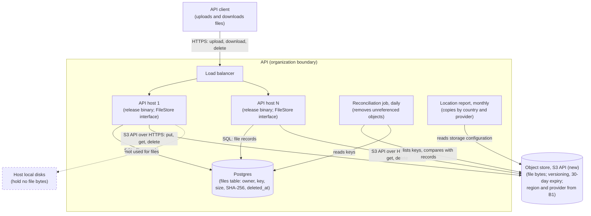
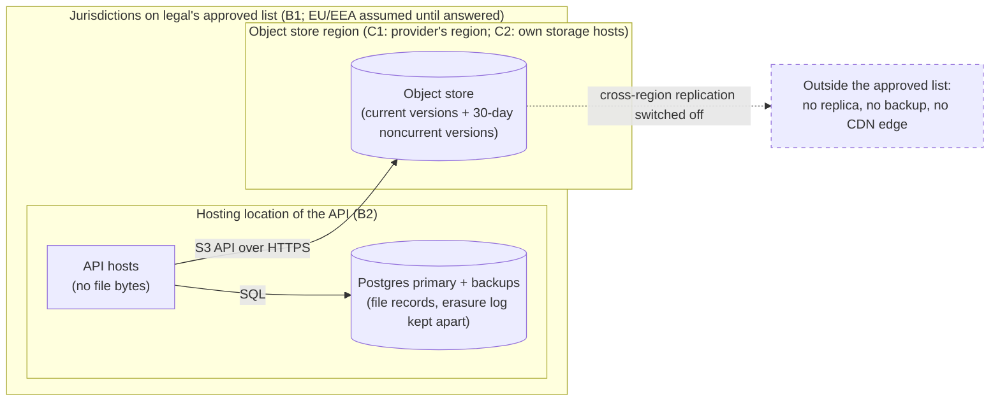

# Design doc: Where the API keeps the files its clients upload

**Status:** proposed. Two blocking questions are open (B1 legal, B2 hosting location). The status
cannot become *accepted* until both are answered.
**Decider:** API tech lead (*assumed*: nobody is named in the request; the team should confirm) ·
**Reviewers:** legal counsel (B1), operations owner for the API hosts (B2, N1, N3, N5), owner of the
Postgres database (option D, N2, N3)
**Current working focus:** decision, held at proposed

## Reversibility

**One-way door on where the bytes physically sit; close to a two-way door on which storage product
holds them.** Once a file has been copied to a jurisdiction the law or a customer contract does not
allow, that transfer cannot be undone; and once months of files sit in one store, moving them is a
migration with checksums, a cutover and a rollback plan. The choice of storage product behind the
API's code can be made cheap to revisit by keeping it behind one internal interface (see Design), so
that dimension gets less space below. The one-way part earns the full method and named reviewers.

## Context

The API is built as one static binary per release and deployed by copying that file onto each host
(ADR 0001, `docs/adrs/0001-ship-the-api-as-a-single-binary.md`; *measured*: read from the record).
That record exists because deploys used to copy a virtualenv and "drifted between hosts", so the API
runs on more than one host (*estimated* from the plural in ADR 0001; the exact count is not recorded
in this repository). The same record notes that the hosts run no container runtime. A host today
holds nothing that a deploy cannot recreate: that is what "a deploy is one file copy" means.

The API now needs to accept files from its clients and give them back later. The team has named three
places to keep them: the local disk of each host, an S3-compatible object store, or Postgres large
objects. Nothing is decided. Legal has not yet said whether these files may be stored outside the
European Union.

This repository contains only the decision records under `docs/adrs/` and no API source, so several
facts a design doc would normally measure are not visible from here. Each is labelled below, with what
would confirm it:

- Whether the API accepts any uploads today. We proceed as if this is a new capability and no files
  exist yet (*assumed*; the API owner can confirm in one message). If files already sit on host disks,
  the Launch strategy gains a copy-and-verify step.
- That the API's own database is Postgres. The request names Postgres large objects as an option,
  which implies it (*assumed*; confirm from the API's configuration).
- Upload volume, typical and maximum file size, and how long files are kept. Nobody has stated them
  (*assumed unknown*; a launch forecast from the product owner would close it). Option D's viability
  depends on them; the recommended option does not, which is why this is non-blocking.
- Where the hosts and the Postgres primary physically run. Not recorded here, and it decides whether
  options A, B, C2 and D are inside the EU at all (*unknown*; this is blocking question B2).

**The problem.** Today a host is disposable, because it holds nothing a deploy cannot recreate. An
uploaded file is the first thing the API must keep that a deploy cannot recreate, and it has to be
kept somewhere that (1) every host can read, (2) survives the loss of any one host, (3) can be shown
to sit only where law and contracts allow, and (4) lets a person's file be erased on request. None of
the three named options obviously satisfies all four, and the third depends on an answer from legal
that has not arrived.

### Current usage

| Role (what they do with the system) | What they do today | Through what | How often or how much (source) |
| --- | --- | --- | --- |
| API client uploading a file | Nothing yet: the capability is new | The API, from several hosts | Unknown volume and sizes (*assumed unknown*; product owner's launch forecast closes it) |
| API client downloading a file it uploaded, or one a colleague uploaded | Nothing yet | The API | Unknown (*assumed unknown*, as above) |
| Operator deploying or replacing an API host | Copies the release binary onto the host | One file copy per host (ADR 0001) | Once per release per host; release frequency not recorded here (*assumed*; the deploy log would say) |
| Operator restoring the service after a failure | Restores the Postgres database from its backups | Postgres backups | Backup schedule, retention and last restore time are not recorded here (*assumed*; the database owner can state them) |

### Goals

| Goal | Who benefits | How we will know |
| --- | --- | --- |
| G1. A client who uploads a file gets the same file back whenever they, or a colleague they authorized, ask for it | API clients | Support tickets about missing or corrupted files, counted per quarter from the support queue; target zero |
| G2. The organization can tell a customer, an auditor or a regulator where a customer's files are held, and show they stayed within what law and contracts allow | Legal counsel answering location questions; customers whose contracts restrict location | A location question is answered from records, without engineering investigation, within one working day |
| G3. A person who asks for their file to be erased has it erased within the legal deadline | Data subjects whose personal data is in a file | Erasure requests closed within one month of receipt (GDPR Art. 12(3)), counted from the request log |
| G4. Operators keep adding and replacing API hosts the way they do today | Operators | The host replacement runbook keeps no file-copy step |

### Stakeholders

| Role (what they do with the system) | What they need from this decision | Who speaks for them |
| --- | --- | --- |
| API client uploading and downloading files | Files come back intact, from whichever host answers | Product owner for the API |
| Account administrator deleting a file | A deleted file stops being downloadable at once, and is gone from every copy within the legal deadline | Product owner for the API |
| Data subject whose personal data may be in an uploaded file | Their data stays where the law allows, and is erased on request | Legal counsel (data protection) |
| Legal counsel answering a location or transfer question | A list of every place the bytes and their copies sit, and the contracts covering each | Legal counsel |
| Operator running the API hosts | Hosts stay replaceable by a file copy; no new stateful service to run unless it pays for itself | Operations owner for the API hosts |
| Owner of the Postgres database (negative stakeholder for option D) | The database does not grow so large that backups and restores slow down | Database owner |
| Budget owner | A storage cost that follows stored volume, with no surprise egress or minimum fees | Engineering manager (*assumed*) |

### Constraints

| Constraint | Source (outside the organization, or a signed commitment) | What it excludes, and the clause |
| --- | --- | --- |
| Personal data may be transferred to a country outside the EU/EEA only under an adequacy decision or with appropriate safeguards | GDPR (Regulation (EU) 2016/679), Chapter V, Art. 44 (general principle), Art. 45 (adequacy), Art. 46 (safeguards such as standard contractual clauses). Applies if uploaded files contain personal data, which we *assume* for client uploads until legal says otherwise (B1) | Nothing outright. It excludes storing files outside the EU/EEA **without** a transfer basis. Which options it excludes in practice depends on B1 |
| A data subject's erasure request is answered without undue delay, and within one month | GDPR Art. 17(1) (right to erasure) and Art. 12(3) (one month to act on a request) | Nothing outright; it sets the 30-day ceiling in F2 and bounds how long any backup may keep deleted bytes |
| Any customer contract or data processing agreement that restricts storage location or sub-processors | Customer contracts; whether any such clause exists is part of B1 (*unknown*) | Unknown until B1 is answered |

### Prior decisions

| Prior decision | Who made it, when | Incumbent it implies | Cost to reverse |
| --- | --- | --- | --- |
| The API ships as one static binary per release; a deploy is one file copy; hosts run no container runtime | ADR 0001; author and date not recorded in the file | Hosts hold no state a deploy cannot recreate. This favours keeping files off the hosts, and it means any self-hosted store must also run as a plain binary, not a container | High: a container runtime or stateful hosts would change every deploy and every host replacement |
| The API's database is Postgres | Not recorded in this repository (*assumed*, see Context) | Option D, Postgres large objects, reuses it | High for the database itself; not in question here. Only its use for file bytes is |
| The option list is local disk, object store, Postgres large objects | The requester, 2026-10 | The three rows A, C and D below | Low: it is a framing, not a commitment. Two options nobody named (B, C2) and the baseline were added beside them |

### Assumptions and open questions

**Blocking** (any answer changes the decision; the status stays proposed while one is open):

| ID | Question | Owner | Date | What each answer changes |
| --- | --- | --- | --- | --- |
| B1 | (a) Can uploaded files contain personal data? (b) Does any customer contract or data processing agreement restrict where data is stored or which sub-processors may hold it? (c) If storage must stay in the EU/EEA, is an EU region of a provider headquartered outside the EU acceptable, or must the provider be EU-controlled? (d) If files may leave the EU, is the EU-US Data Privacy Framework (Commission adequacy decision of 2023-07-10) or standard contractual clauses an acceptable basis? | Legal counsel | 2026-11-20 (*proposed date*; legal to confirm) | "No personal data and no contract clause": any provider and region; choose on cost and latency. "EU/EEA only, any provider's EU region acceptable": C1 with any provider offering an EU region. "EU/EEA only and EU-controlled provider required": C1 with an EU-headquartered provider, or C2 if none can be contracted; D becomes the fallback if volume is small. "May leave the EU with a transfer basis": C1 with any provider, plus the transfer basis recorded in the provider's DPA |
| B2 | In which country do the API hosts and the Postgres primary, its replicas and its backups run? | Operations owner | 2026-11-06 (*proposed date*; one look at the hosting contract) | Inside the EU/EEA: options A, B, C2 and D inherit that location and remain eligible under any B1 answer. Outside: those four store files outside the EU too, and the B1 answer applies to them as much as to C1 |

The question as first posed, "may files leave the EU?", does not separate the options by itself. Local
disk, a shared filesystem, a self-hosted object store and Postgres all keep files wherever the hosts
already are, and a managed object store can be placed in an EU region. What separates the options is
part (c) of B1: whether a non-EU provider's EU region is acceptable. Legal should be asked that
question in those words.

**Non-blocking:**

- Upload volume and file size are unknown (*assumed unknown*). The recommended option does not depend
  on them. Option D does: it stays viable only while a full database restore, files included, fits
  within N3. The product owner's launch forecast closes this; the restore drill in N3 measures it.
- No upload feature exists yet, so nothing needs migrating (*assumed*; the API owner confirms).
- The API's hosts sit behind a load balancer that can send consecutive requests from one client to
  different hosts (*assumed* from "drifted between hosts" in ADR 0001; the load balancer configuration
  would confirm). If every client is pinned to one host forever, option A's F1 gap narrows but does
  not close, because host replacement still loses the files.
- Clients reach the API over the public internet, so download latency is dominated by the client's
  link rather than the store (*assumed*). Latency is therefore not a requirement below; if the team
  measures otherwise, a latency row is added.

### Out of scope

- **Virus and content scanning of uploads.** A separate problem with its own requirements; every
  option below can hand bytes to a scanner.
- **Which file types and sizes the API accepts.** A product rule. The design reads it from
  configuration; it does not decide it.
- **Where the rest of the API's data (the Postgres database itself) is hosted.** B2 asks where it is;
  moving it is a different decision.

## Requirements

Nothing in the request was a requirement as stated, so most of this section is new. Four things moved
or were added, and the reviewer should check them:

- "Local disk, an S3-compatible object store, or Postgres large objects" are design choices and appear
  as rows in the tradeoff table, beside two options nobody named and the do-nothing baseline.
- "Legal must confirm whether files may leave the EU" is a constraint (GDPR Chapter V) plus a blocking
  question (B1), rewritten to ask the question that separates the options.
- **F2 (erasure) and F4 (location answer) are the architect's additions.** The request did not mention
  them. They serve the data subject (G3) and legal counsel (G2); the requester has not reviewed them,
  and that is recorded under Stakeholder conflicts.
- "Keep hosts as they are" is not a requirement but a prior decision (ADR 0001). N5 is the requirement
  derived from it, stated as what operators observe.

### Functional

| ID | Goal | Requirement (the role, and what the system does for it) | Proof (the scenario, and how it is run) | Source |
| --- | --- | --- | --- | --- |
| F1 | G1 | An API client can upload a file and later download the same bytes, whichever host handles either request | Given a file uploaded through host A, when the client downloads it through host B, then the bytes match the upload's SHA-256; run as an integration test against two hosts, and repeated after host A is replaced | Context: the API runs on more than one host (ADR 0001) |
| F2 | G3 | An account administrator can delete a file; from that moment no client can download it, and within 30 days no copy of its bytes (primary, replica, backup, cache) can be recovered | Given a deleted file, when any client requests it, then the API answers 404; and 30 days later a search of every copy for its storage key finds nothing; run as an integration test plus a quarterly check of backup retention settings | GDPR Art. 17 and Art. 12(3); architect's addition |
| F3 | G1 | An API client can download only files its account is authorized to read | Given a file belonging to account X, when a client of account Y requests it by its identifier, then the API answers 404 and no byte is sent; run as an integration test on every download path, including any direct-download link | Every option exposes stored bytes; the authorization point must be named |
| F4 | G2 | Legal counsel can obtain, for any file, the jurisdiction and provider holding each copy of its bytes | Given a file identifier, when counsel asks for its location, then a report lists every copy with country and provider, generated from records rather than by inspecting machines; run once before launch as a drill and quarterly after | B1; constraint table (GDPR Chapter V) |

### Non-functional

| ID | Goal | Requirement (metric, target, condition) | Derived from | Proof (measurement) | Source |
| --- | --- | --- | --- | --- | --- |
| N1 | G1 | Files unreadable or with a mismatched checksum, in a sample of 1,000 stored files, after the permanent loss of any one API host or any one disk: 0. Any unreadable file fails the drill | There is no current value: the capability is new. The target is G1's: a file lost to an ordinary host failure is a file lost to the client. Host loss is an ordinary event on a multi-host service (ADR 0001) | Failure drill before launch and twice a year: remove a host or disk, read the sample, compare checksums | G1; ADR 0001 |
| N2 | G1 | After restoring the database to any point in the last 30 days, file records that do not resolve to bytes with a matching checksum: 0. Stored bytes with no record are removed within 7 days | 30 days is the longest window the erasure deadline (F2) allows any copy of deleted bytes to survive, so it is also the longest restore window that can be honoured. 7 days is *assumed* (cleanup cost, not a legal limit) | Restore drill quarterly: restore to a random point inside the window, run the reference check over every record | F2; G1 |
| N3 | G1, G4 | A full restore of the service, database and file bytes both readable, completes within 4 hours | *Assumed*: no recovery-time objective is recorded in this repository and the current restore time is not measured. The database owner states the real objective, and the first restore drill measures today's value before the target is final | Restore drill on production-sized data before launch, then quarterly; time from start to first successful F1 scenario | Operator restoring the service (Current usage) |
| N4 | G2 | Copies of file bytes (primary, replica, backup, cache) held outside the jurisdiction list legal approves under B1: 0, checked monthly | GDPR Chapter V and B1's answer; the list itself is pending B1 | Monthly location report (F4) compared with the storage configuration and the provider's contracted regions and sub-processors | B1; constraint table |
| N5 | G4 | Adding or replacing an API host copies no file bytes onto it, and the new host serves F1 as soon as the release binary is in place | ADR 0001: "A deploy is one file copy". The target keeps that property | Host replacement drill before launch: replace a host by the standard deploy, then run the F1 scenario against it | ADR 0001 |

## Design

The design answers the requirements dimension by dimension. Where a choice depends on B1 it says so.
The tradeoff analysis that follows compares it with the alternatives; this section describes the
design that analysis ends up recommending.

### Where the bytes live

The bytes live in an **object store reached through the S3 API**, in a region and under a provider
taken from legal's approved list (N4). The file record (identifier, owning account, size, SHA-256,
content type, storage key, created and deleted timestamps) lives in a `files` table in the API's
Postgres database (F3, F4). The S3 API is the stable part: a managed provider in an EU region (C1) and
a self-hosted S3-compatible server on the organization's own EU hosts (C2) are reached the same way, so
B1 changes an endpoint and a contract, not the code.

The object store keeps several copies of each object across devices in one region (N1) and keeps
deleted or overwritten versions for 30 days through a versioning and lifecycle rule, then expires them
(N2, F2). Replication outside the region is switched off and no CDN sits in front of the store (N4),
because a CDN's edge caches would hold copies in places the location report cannot list.

### How keys and records stay consistent

Each upload gets a new random storage key, and keys are never reused or overwritten. The API writes
the bytes first and inserts the `files` row second, in that order (N2). A crash between the two leaves
bytes with no record; a daily reconciliation job deletes objects older than 24 hours that no record
names (N2's 7-day target). Because objects are immutable and deleted versions survive 30 days,
restoring Postgres to any point in that window finds every object its records name (N2).

Deletion marks the row deleted and deletes the object in the same request. The API answers 404 from
that moment (F2); the store's lifecycle rule removes the last version within 30 days (F2). The
erasure log (the identifiers of erased files) is kept outside the database backups, and every database
restore re-applies it, so a restore cannot bring an erased file back.

### The data path

For the first release the API streams bytes in both directions: the client sends the upload to the
API, the API streams it to the store, and downloads come back the same way (F3). Authorization is
checked in one place, the API, before any byte moves. Streaming, rather than buffering whole files in
memory, keeps a host's memory use independent of file size. Direct-to-store links (presigned URLs) are
a later, two-way-door option if hosts' bandwidth becomes the bottleneck; they are weighed in the
tradeoff table.

### Keeping the backend swappable

A single `FileStore` interface in the API (put, get, delete, list-by-prefix) hides the store. The S3
adapter is the only implementation shipped; CI runs it against a local S3-compatible server. This is
what keeps the backend choice close to a two-way door: moving from C1 to C2, or between providers,
becomes a copy job plus a configuration change.

### Location records

The storage configuration (provider, region, replication settings, backup locations) is recorded in
the repository alongside the API's configuration, and a monthly job produces the location report from
it and from the provider's sub-processor list (F4, N4).

### Hosts

Hosts hold no file bytes, so replacing one remains a release-binary copy (N5, ADR 0001). If B1 forces
C2, the self-hosted object store runs as a plain binary on separate storage hosts, because ADR 0001's
hosts have no container runtime; those storage hosts are stateful, and the API hosts are not.

### Static view



*Figure 1. C4 container diagram of the proposed state. Answers F1, F3, F4, N1, N2, N4, N5.*

### Dynamic view

```mermaid
sequenceDiagram
    actor C as API client
    participant H as API host (any)
    participant S as Object store
    participant P as Postgres
    C->>H: POST /files (bytes)
    H->>H: authorize account; stream and hash (F3)
    H->>S: PUT new random key (bytes streamed)
    S-->>H: stored (copies across devices, N1)
    H->>P: INSERT files row (key, SHA-256, owner)
    P-->>H: committed
    H-->>C: 201 Created, file id
    Note over H,S: crash between PUT and INSERT leaves an orphan;<br/>daily reconciliation removes it (N2)
    C->>H: GET /files/{id} (possibly a different host, F1)
    H->>P: SELECT row WHERE id AND owner AND deleted_at IS NULL (F3)
    P-->>H: key, SHA-256
    H->>S: GET key
    S-->>H: bytes
    H-->>C: 200, bytes streamed
    C->>H: DELETE /files/{id}
    H->>P: set deleted_at; append to erasure log (F2)
    H->>S: DELETE key (version expires within 30 days, F2)
    H-->>C: 204; later GETs answer 404
```

*Figure 2. Sequence for upload, download from another host, and delete; container level. Answers F1,
F2, F3, N1, N2.*

### Deployment view: where each copy sits



*Figure 3. Deployment view, by jurisdiction. Answers F4, N4.*

## Alternatives analysis (Tradeoff)

### Decision drivers

1. **N4 and F4, data location** (GDPR Chapter V, B1): a veto. An option that cannot be shown to keep
   every copy inside the approved list is out, whatever else it scores.
2. **N1 and N5, no file lost to a host failure, and hosts stay replaceable by a file copy** (G1, G4,
   ADR 0001): next, because they are the two properties the current deployment model depends on.
3. **N2 and N3, restore consistency and restore time**: a store whose backups drift from the
   database's, or that makes the database too slow to restore, fails G1 on the worst day.
4. **Operational load on the team.** The team size is not recorded here (*assumed* small); every new
   stateful service needs an owner, a drill and an on-call runbook.
5. **Cost of ownership**, which cannot be quantified until the volume forecast arrives.
6. **Reversibility**: data location is a one-way door, so B1 must be answered first; the backend is
   made close to a two-way door by the `FileStore` interface.

### What every option shares

Every option named in the request assumes four things, and each is accounted for here:

- **The API stores files at all.** The alternative is not to accept uploads; it is the baseline row.
- **The bytes pass through the API.** None of the three named options says how bytes travel. Streaming
  through the API and direct-to-store links are both given rows, under the data-path dimension.
- **Postgres holds the file records.** A prior decision (table above). No option stores records
  elsewhere, and none needs to: the records are small and relational. Not given a row.
- **The hosting location stays where it is.** Whether that is inside the EU is B2. Moving hosting is
  out of scope; the location report (F4) covers whatever B2 finds.

Two options nobody named were added: a **shared network filesystem** (B), the closest thing to "local
disk, but every host sees it", and a **self-hosted S3-compatible store** (C2), split out from the
object-store option because B1's answer may make it the only object store legal accepts. Postgres
`bytea` columns (D2) sit beside large objects because a team choosing Postgres will ask about them.

| Alternative | Requirements (met / partial / missed, by ID) | Pros | Cons | Risk | Impact | Probability | Mitigation | Contingency |
| --- | --- | --- | --- | --- | --- | --- | --- | --- |
| **[Where bytes live] A. Local disk on each host** (named in the request) | met: F3, F4; partial: F2 (each host's disk backups must also expire within 30 days), N4 (met only if B2 places hosts in the EU), N3 (restore means restoring every host's disk to the same point as the database); missed: F1 (a file written on one host is absent on the others), N1 (one disk failure loses its files), N2 (host disks and database are backed up separately), N5 (a host becomes stateful; replacement needs a file copy) | No new dependency or provider; lowest latency; no egress cost; location follows the hosts | Breaks ADR 0001's disposable hosts; needs sticky routing and per-host backups to work at all | Files lost when a host or disk fails | High (G1: a client's file is gone) | High (host loss is the ordinary event ADR 0001's multi-host setup exists for) | Replicate between hosts (rsync or similar) | Restore from host backups, with files after the last backup lost |
| | | | | A host replacement silently strands its files | High | High (every replacement) | Copy step in the runbook | Recover from the old host's disk if it still exists |
| **[Where bytes live] B. Shared network filesystem mounted on every host** (not named) | met: F1, F2, F3, F4, N5; partial: N1 (met only if the file server itself is redundant), N2 (filesystem and database backed up separately; snapshots must be coordinated), N3 (unmeasured), N4 (met if B2 places it in the EU) | Code treats it as a local path; no external provider; location follows the hosts | A new stateful server for the team to run, patch and back up; a single file server is a single point of failure; mount failures surface as I/O errors in the API | File server outage stops all uploads and downloads | High | Medium (one server, no redundancy unless bought) | Redundant file server or managed network filesystem | Fall back to read-only mode; restore from snapshot |
| **[Where bytes live] C1. Object store, managed provider, region from B1** (named in the request; recommended if B1 allows a provider) | met: F1, F2 (versioning plus a 30-day lifecycle rule), F3, F4 (region and sub-processors are contract terms), N1 (provider keeps several copies across devices), N2 (immutable keys plus 30-day versions), N3 (file bytes need no restore, only the database), N5; partial: N4 (met only for a provider and region B1 approves) | No storage servers to run; cost follows stored volume; the same S3 API as C2, so B1 changes configuration, not code | A new sub-processor (contract and DPA work); egress fees on downloads; the API depends on the provider's availability | B1 rules out non-EU-controlled providers and the shortlisted provider is one | High (rework of contract and possibly a migration) | Medium (B1 is open; part (c) is the exact question) | Ask B1(c) before signing; shortlist both an EU-headquartered provider and a non-EU provider's EU region | Switch provider through the `FileStore` interface; copy and verify by checksum |
| | | | | Egress cost outgrows the budget | Medium | Unknown until the volume forecast; recorded as a gap, closed by the forecast | Price the forecast against two providers before signing | Cache downloads on API hosts' disks (bytes stay in the same jurisdiction) |
| | | | | Provider outage blocks uploads and downloads | Medium | Low (object stores in one region are run across several devices and facilities; exact figures are in each provider's service terms) | Retries with backoff; clear error to clients | Read-only degradation; status page |
| **[Where bytes live] C2. Object store, self-hosted S3-compatible server on own EU hosts** (not named separately) | met: F1, F2 (if the server supports versioning and lifecycle rules), F3, F4, N4 (if B2 places hosts in the EU), N5 (API hosts stay stateless); partial: N1 (needs enough storage nodes and disks for erasure coding; the host count is not recorded here), N2 (versioning support varies by server), N3 (the team restores the store itself) | No new sub-processor; location under the organization's full control; same S3 API as C1; runs as a plain binary, so it fits ADR 0001's no-container hosts | A distributed storage system for the team to run: capacity planning, disk replacement, upgrades, an on-call runbook | Operational mistakes lose data (disk replacements, rebalancing) | High | Medium (a small team without storage experience; *assumed* small) | Start with the minimum node count the chosen server documents for erasure coding; failure drills (N1) before launch | Restore from the store's own backups to a second site in the EU |
| | | | | The chosen server's project changes licence or stops publishing releases | Medium | Medium (licence and distribution changes have happened in this product category; check before choosing) | Pick a server with an active community and a licence legal accepts | Migrate to another S3-compatible server or to C1 via the `FileStore` interface |
| **[Where bytes live] D. Postgres large objects** (named in the request; incumbent of the "Postgres" prior decision) | met: F1, F3, F4, N1 (as far as the database's own replication and backups reach), N2 (bytes and records commit in one transaction), N4 (if B2 places the database in the EU), N5; partial: F2 (deleting needs `lo_unlink` or the `vacuumlo` cleanup; the bytes persist in database backups and WAL archives until their retention expires, which must be 30 days or less), N3 (restore time grows with every stored byte; the threshold depends on volume, which is unknown) | No new service, provider or contract; one backup covers records and bytes; transactional consistency for free; location follows the database | The database grows with every file, so backups, restores and replica builds slow down; logical replication does not copy large objects; each download holds a database connection while it streams; the database owner pays the cost | Database restore time exceeds N3 as files accumulate | High (the whole API is down during a restore, not just files) | Unknown until the volume forecast; recorded as a gap, and the N3 drill measures it | Restore drill each quarter with the real database; set a size alarm at the volume where the drill approaches 4 h | Migrate bytes to C1 or C2 through the `FileStore` interface, keeping records in place |
| | | | | Long downloads exhaust the connection pool | Medium | Medium (depends on file size and concurrency, both unknown) | Separate small pool for file streaming; size limits | Move downloads to an object store |
| **[Where bytes live] D2. Postgres `bytea` column** (not named) | met: F3, F4, N2, N5; partial: F1 (each value is capped at 1 GB and is read whole into memory, so large files fail), F2, N3 (as D); N1 and N4 as D | Simplest code of all; transactional | As D, plus whole-file memory use per request | Large uploads exhaust host memory | High | Unknown (maximum file size not stated) | Hard size limit well below 1 GB | Move to D or C |
| **[Data path] P1. API streams bytes both ways** (recommended for the first release) | met: F3 (one authorization point), N5; neutral on the rest | Authorization and logging in one place; clients see one endpoint; no store credentials or links leave the API | API hosts carry every byte: bandwidth and egress pass through them | Hosts' bandwidth saturates on large or frequent downloads | Medium | Unknown until the volume forecast | Streaming without buffering; per-request size limits | Move downloads to P2 (a two-way door) |
| **[Data path] P2. Short-lived direct links to the store (presigned URLs)** | met: F1, N5; partial: F3 (a link works for anyone who has it until it expires) | Offloads bandwidth from API hosts; downloads go straight from the store | Only works with C1 or C2; links can be forwarded during their lifetime; clients contact the store's endpoint directly, which legal may need to know for C1 | A forwarded link exposes a file to someone not authorized | Medium | Low with a lifetime of minutes | Expiry of 5 minutes or less; links issued only after the F3 check | Rotate the store's signing credentials to invalidate all links |
| **Baseline: do nothing; the API does not accept uploads** | missed: F1, F2, F3, F4 (no capability); N1 to N5 not applicable | No cost, no legal exposure, no new dependency | The capability the product asked for does not exist; clients keep files elsewhere and link to them | Clients put files in places the organization neither controls nor can report on | Medium (G2 cannot be met for data outside our systems) | Medium (clients already need somewhere to keep files, otherwise this request would not exist) | None without building the capability | None |

Every option is stated at its best. Local disk (A) is the right answer for a single, disposable host
with files that can be lost, which is not this API. Postgres large objects (D) are the right answer
when volume stays small enough that a full database restore, files included, fits within N3, and
when no one is available to own another service; their transactional consistency is better than
anything the object-store design builds by hand with immutable keys and a reconciliation job. A
self-hosted store (C2) is the right answer when B1 rules out every provider the organization can
contract.

**The strongest objection to the recommendation** is that it adds a sub-processor and a network
dependency to answer requirements that Postgres large objects meet today with no new contract, and
that with an unknown and possibly small volume, D might never reach the size where N3 hurts. **The
decision flips to D** if (1) the volume forecast puts total stored bytes, three years out, at a size
where the N3 restore drill still completes within 4 hours, and (2) B1 rules out managed providers, and
(3) operations cannot own a self-hosted store. All three together, not any one.

## The decision

**Recommendation (status: proposed, held by B1 and B2):** keep file bytes in an **object store reached
through the S3 API (C)**, with records in Postgres, behind a `FileStore` interface, and **stream bytes
through the API (P1)** for the first release. Which variant of C is chosen depends on B1:

| B1 answer | Variant |
| --- | --- |
| No personal data and no contract clause, or files may leave the EU with a transfer basis | C1, any provider; choose on price for the forecast volume and on download latency |
| EU/EEA only; a non-EU provider's EU region is acceptable | C1, any provider with an EU region, cross-region replication off |
| EU/EEA only; the provider must be EU-controlled | C1 with an EU-headquartered provider; C2 if none can be contracted; D if all three flip conditions above hold |

The drivers that carry it: C is the only option that meets N1, N2, N3 and N5 together without growing
the database or making hosts stateful (drivers 2 and 3), and its S3 interface lets legal's answer to
B1 change the provider without changing the code (driver 1, driver 6). A and D2 are rejected on F1,
N1 and N5; B on its single file server (N1) and the operational load it adds for less than C gives.
D is kept as the named fallback under the conditions stated above.

**Decision style: autocratic.** The API tech lead owns the call (*assumed*; the team confirms or names
the decider), after consulting legal counsel on B1, the operations owner on B2, N1, N3 and N5, and the
database owner on D and N3.

**Blocking questions, restated here because they hold the status:**

- **B1** (owner: legal counsel; date 2026-11-20, proposed): personal data in files, contract clauses,
  and above all whether a non-EU provider's EU region is acceptable. The variant table above maps each
  answer to its option.
- **B2** (owner: operations owner; date 2026-11-06, proposed): the country of the API hosts and the
  Postgres primary, replicas and backups. If outside the EU/EEA, every option, including today's
  database, is subject to B1, and this document gains a section on that.

Development of the `FileStore` interface, the `files` table and the S3 adapter against a local
S3-compatible server in CI can start before B1 closes, because they are the same under every
recommended variant. No file is stored at a provider, and no provider contract is signed, before B1
closes.

### Stakeholder conflicts

- **F2 (erasure) and F4 (location report) were added by the architect**, not by the requester. They
  serve the data subject (G3) and legal counsel (G2). The requester has not yet reviewed them. If the
  requester objects, the objection is recorded here and the decider rules on it; until then they stay.
- **The database owner against option D.** D puts every file into the database the owner protects; the
  recommendation sides with the owner, and D survives only as a fallback with a size alarm.
- **Operations against C2.** If B1 forces C2, operations gains a stateful storage system the current
  deployment model was designed to avoid (ADR 0001). That cost is in the C2 row; it is the price of
  legal's answer, not of this recommendation.

### Consequences

- API hosts stay disposable: replacing one remains a file copy (N5).
- The organization gains a sub-processor (C1) or a storage system to operate (C2); either needs an
  owner, a contract or a runbook, and an entry in the location report.
- Records and bytes live in two systems, so consistency is the team's job: immutable keys, versions
  kept 30 days, a daily reconciliation job and the erasure log re-applied after every database restore.
- Download traffic passes through the API hosts until P2 is adopted, so host bandwidth becomes a
  capacity metric to watch.
- Changing provider later is a copy-and-verify job behind the `FileStore` interface, not a code change.

### Residual risks

- B1's answer could exclude the provider the team prefers after work has started. Mitigated by not
  signing before B1 closes; the code is unaffected.
- Volume is unknown, so egress cost (C1) and restore time (D, if chosen) are unquantified until the
  forecast arrives.
- A database restore re-applies the erasure log only if the runbook says so; a restore done without it
  would bring back records of erased files whose bytes may still be inside the 30-day window.

### Confirmation

- The N1 failure drill, N2 and N3 restore drills and N5 host replacement drill run before launch and on
  their stated schedules; a failed drill reopens this document.
- N3's 4-hour target is *assumed*; the first restore drill measures the real value, and the database
  owner confirms or replaces the target.
- The monthly location report (F4) is compared with legal's approved list (N4); any copy outside the
  list is an incident.
- A CI test exercises the F1, F2 and F3 scenarios on every release.
- Review date: three months after launch, with the measured volume, egress cost and restore time,
  or sooner if B1 is answered in a way the variant table does not cover.

## Launch strategy

1. **Before B1 closes.** Build the `FileStore` interface, the `files` table, the S3 adapter and the
   reconciliation job; test them in CI against a local S3-compatible server. Close B2. Get the volume
   forecast.
2. **When B1 closes.** Pick the variant from the table, sign the provider contract and data processing
   agreement (C1) or stand up the storage hosts (C2), create the bucket in the approved region with
   versioning, the 30-day lifecycle rule and replication off. Run the N1, N2, N3 and N5 drills and the
   F4 location drill.
3. **Launch.** Enable uploads for all clients. If any files turned out to exist on host disks
   (Context assumption), copy them to the store, verify each SHA-256, switch reads to the store, and
   delete the host copies in the same release cycle, with no period where both are written.
4. **After three months.** Review against Confirmation; decide on P2 if host bandwidth requires it.

Nothing else is migrated, and the host disks are never used for files.

## Tasks and roadmap

| Task | Description | Estimate (*assumed*) |
| --- | --- | --- |
| Ask legal B1 in its four parts | Send the exact questions, with the variant table, to legal counsel | 0.5d |
| Close B2 | Read the hosting contract for host, database and backup locations | 0.5d |
| `FileStore` interface and S3 adapter | Streaming put/get/delete; CI against a local S3-compatible server | 3d |
| `files` table and endpoints | Upload, download, delete; F3 checks; 404 after delete | 3d |
| Reconciliation job and erasure log | Daily orphan cleanup; erasure log stored outside database backups; restore runbook step | 2d |
| Store provisioning (after B1) | Bucket or storage hosts, versioning, 30-day lifecycle, replication off, credentials | 1–5d (C1 at the low end, C2 at the high end) |
| Location report | Monthly report from storage configuration and provider sub-processor list (F4, N4) | 1d |
| Drills | N1, N2, N3, N5 and F4 drills before launch; schedule the recurring ones | 2d |
| API contract and runbook | OpenAPI entries for the file endpoints; restore runbook with the erasure-log step | 1d |
| Record the decision | When accepted, write ADR 0002 in `docs/adrs/` from that directory's template, linking this document | 0.5d |

## Glossary

| Term | Meaning |
| --- | --- |
| File | What an API client uploads: its bytes plus its record |
| File record | The row in the `files` table: identifier, owning account, size, SHA-256, storage key, timestamps |
| Storage key | The random, never-reused name under which the bytes are stored |
| Object store | A storage service reached through the S3 API, holding bytes under keys; managed (C1) or self-hosted (C2) |
| S3 API | The HTTP interface for object storage introduced by Amazon S3 and implemented by many providers and servers |
| Large object | Postgres's facility for storing big binary values outside table rows, addressed by an object identifier |
| Presigned URL | A time-limited link that lets its holder read or write one object directly at the store |
| Approved list | The jurisdictions (and, if B1 says so, providers) legal permits for file bytes and their copies |
| Sub-processor | A third party that processes personal data on the organization's behalf, such as a storage provider |
| Erasure log | The list of erased file identifiers, kept outside database backups and re-applied after any restore |
| Host | A machine running the API's release binary (ADR 0001) |

## Sources

- `docs/adrs/0001-ship-the-api-as-a-single-binary.md` in this repository: one static binary per
  release, a deploy is one file copy, hosts run no container runtime, deploys previously drifted
  between hosts.
- `docs/adrs/README.md`: decision records are written only for decisions that have been taken; this
  document stays outside that directory until it is accepted.
- Regulation (EU) 2016/679 (GDPR): Art. 12(3), Art. 17, Chapter V (Art. 44–46).
- Commission Implementing Decision on the adequacy of the EU-US Data Privacy Framework, 2023-07-10
  (current status for legal to confirm under B1).
- PostgreSQL documentation: large objects (`lo_unlink`, `vacuumlo`), the 1 GB limit on a `bytea`
  value, and the logical replication restriction that large objects are not replicated.

## Version history

| Version | Date | Author | Description |
| --- | --- | --- | --- |
| 0.1 | 2026-10-30 | Drafted for the API team's review | Document created; status proposed pending B1 and B2. |
