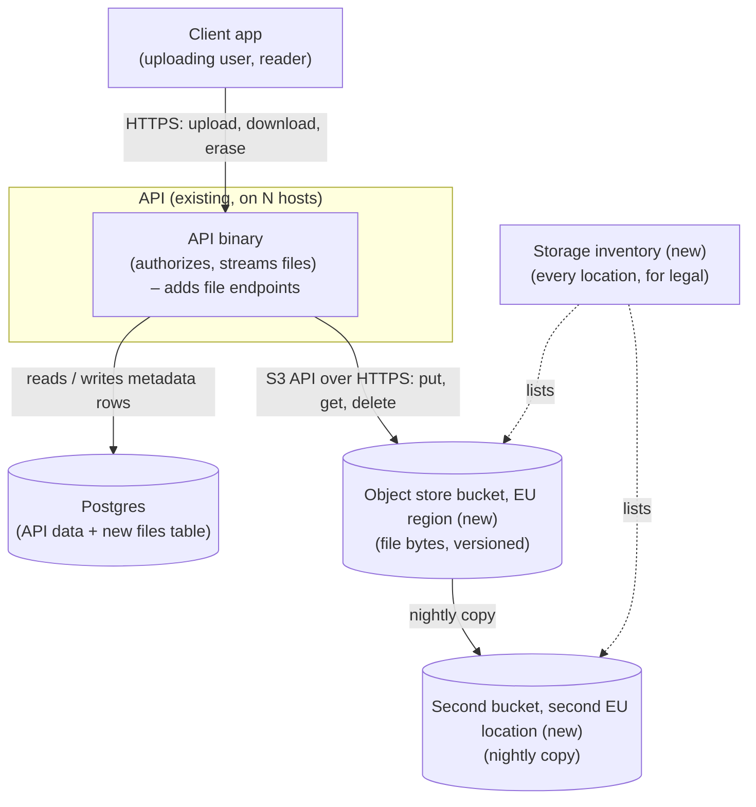
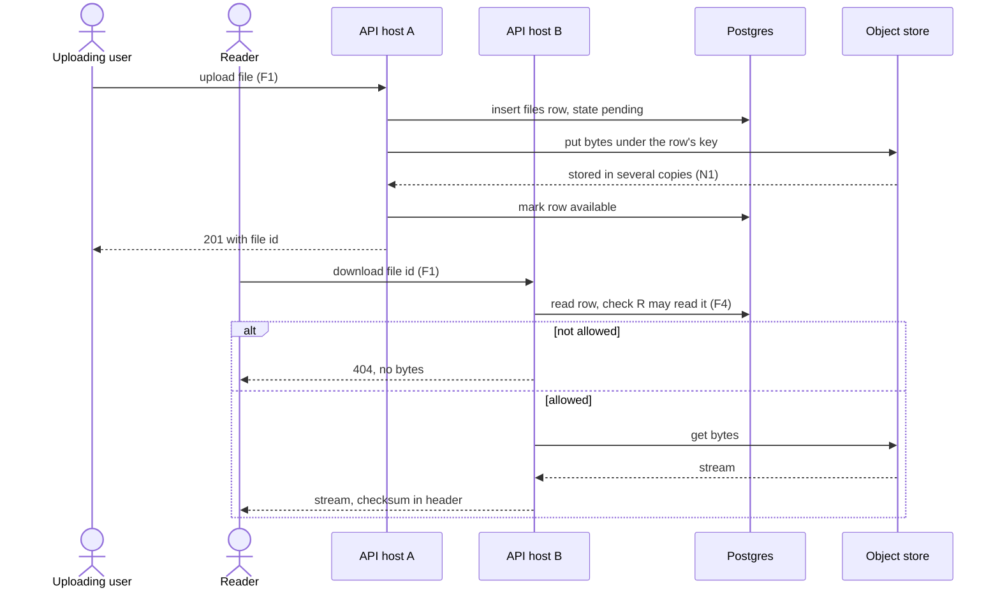
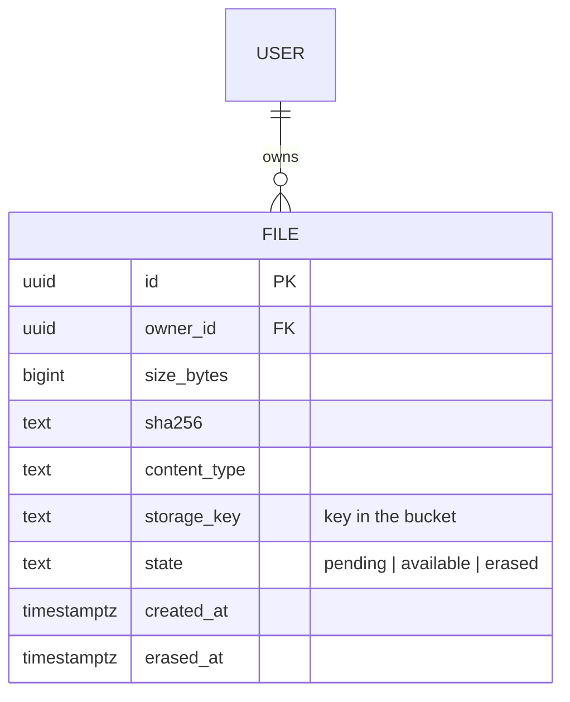
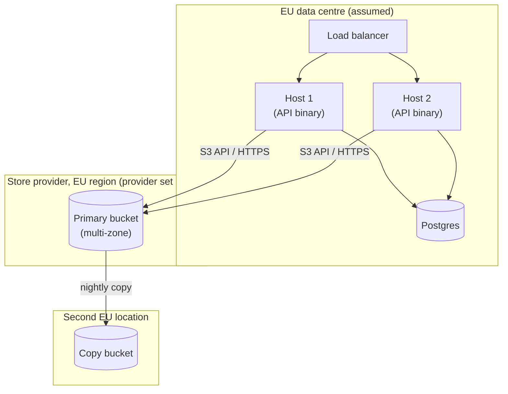

# RFC: Where the API keeps the files users upload

**Status:** proposed (held by two blocking questions; see Assumptions and open questions)
**Decider:** Tech lead of the API (*assumed*; nobody was named)  ·  **Reviewers:** Legal counsel, the database owner, the operator who runs releases, the product owner for uploads
**Current working focus:** decision (waiting on Q1 and Q2)

## Reversibility

**One-way door for the storage model.** Wherever the bytes land first, every stored file has to be
copied out and every file reference rewritten to leave, and that cost grows with every upload. It also
fixes where personal data sits, which is a legal commitment. The choice of provider *inside* the
S3-compatible family is closer to a two-way door: the API speaks one protocol to all of them, and a
bucket can be copied to another provider with a sync tool. So the storage model gets the full method
below, and the provider is decided by the legal answer once it arrives.

## Context

The API is shipped as one static binary per release and deployed by copying that file to each host;
the hosts run no container runtime (`docs/adrs/0001-ship-the-api-as-a-single-binary.md`; *measured*,
read 2026-10-30). That record speaks of drift "between hosts", so the API runs on at least two hosts
(*measured* from the record's wording; the exact count and how requests are spread across them are not
written down anywhere in the repository, so a load balancer that sends any request to any host is
*assumed*; the operator can confirm in minutes).

The API is now to accept files from users. Nothing about the files is recorded yet: the repository
holds decision records only, with no code, schema, configuration or dashboards to measure from
(*measured*: the repository tree, 2026-10-30). The request names three ways to keep them: local disk on
each host, an S3-compatible object store, or Postgres large objects. Naming Postgres implies the API
already uses a Postgres database (*assumed*; the database owner can confirm).

Two facts make this more than a library choice. First, a file written to one host's disk is invisible to
the other hosts, and a host is replaced or re-imaged as part of normal operations, so where the bytes
live decides whether a user gets their file back. Second, the files may contain personal data of people
in the EU (*assumed*; it is the reason legal was asked), and legal has not yet said whether those files
may be stored or processed outside the EU. That answer can rule options in or out, so it sits in the
blocking questions below, not in the constraints.

### Current usage

| Role (what they do with the system) | What they do today | Through what | How often or how much (source) |
| --- | --- | --- | --- |
| Uploading user handing a file to the service | Cannot upload through the API; uses whatever channel exists outside it | Outside the API (*assumed*: email or a shared folder) | Unknown; no upload volume is recorded anywhere in the repository (*assumed* volumes in Q2 and the non-blocking list) |
| Reader retrieving a file someone uploaded | Not possible through the API today | None | None |
| Operator shipping a release | Copies one binary to each host | File copy per host (ADR 0001) | Per release; frequency not recorded (*assumed*: weekly or more) |
| Database owner protecting the API's data | Backs up and restores the Postgres database | Postgres backups | Backup schedule not recorded (*assumed*: nightly; the database owner can confirm) |

**The problem.** The API is about to hold state that is not in the database for the first time, on hosts
designed to be replaceable by copying one file, while the one fact that decides where personal data may
live is still open with legal.

### Goals

| Goal | Who benefits | How we will know |
| --- | --- | --- |
| G1. People who hand a file to the service get the same file back whenever they need it, until they choose to remove it | Uploading user; reader | Support contacts about missing or corrupted files (none today because the feature does not exist; watched from launch) |
| G2. Uploaded files are held only where the organization is allowed to hold them, and are erased when a person asks | The people whose data is in the files; legal counsel answering a regulator | Legal signs off the list of storage locations before launch; erasure requests closed within the one month GDPR Article 12(3) allows |
| G3. Operators keep releasing and recovering the API with the routine they have now | Operator shipping a release; database owner | The release stays one file copy per host (ADR 0001); the restore drill for files passes on the first attempt |

### Stakeholders

| Role (what they do with the system) | What they need from this decision | Who speaks for them |
| --- | --- | --- |
| Uploading user | The file is kept after the API says it was received | Product owner for uploads (*assumed* role) |
| Reader retrieving a file | Gets the file through any host, and only files they are allowed to see | Product owner for uploads |
| Person whose data is in a file (data subject) | Files erased on request; held only where the law allows | Legal counsel |
| Legal counsel answering a regulator | A list of every place a copy of a file is held, including backups | Legal counsel |
| Operator shipping a release and replacing hosts | No per-host state to carry over; no new runtime on the hosts | The operator who runs releases |
| Database owner | The database's backup and restore times do not grow without a ceiling | Database owner |
| Developer maintaining the API | One code path for files, testable without production infrastructure | Tech lead of the API |

### Constraints

| Constraint | Source (outside the organization, or a signed commitment) | What it excludes, and the clause |
| --- | --- | --- |
| Personal data may leave the EU only under an adequacy decision or appropriate safeguards | GDPR (Regulation (EU) 2016/679), Chapter V, Articles 44 to 46 | Nothing yet. Whether any option is excluded is blocking question Q1 |
| A data subject may have their personal data erased | GDPR Article 17, with the one-month response time of Article 12(3) | No option outright; every option must delete the bytes and let backup copies expire (F2) |
| A third party that stores the files on our behalf is a processor and needs a contract | GDPR Article 28(3) | No option; any managed store or hosted service carries a data processing agreement as a cost |

All three apply only if the files contain personal data, which is *assumed* (Q1 settles it as a side
effect).

### Prior decisions

| Prior decision | Who made it, when | Incumbent it implies | Cost to reverse |
| --- | --- | --- | --- |
| The API ships as one static binary copied to each host; hosts run no container runtime | The team, ADR 0001 (date not recorded) | Local disk on each host: the only option that adds nothing to run beside the binary | Medium: a container runtime or a second service on the hosts changes the deploy that ADR 0001 made a single copy |
| The API's data lives in Postgres | Not recorded; implied by the request (*assumed*) | Postgres large objects: files in the store the team already backs up | High to leave Postgres; low to add a second store beside it |
| The option space is local disk, an S3-compatible store, or Postgres large objects | The requester, 2026-10-30 | Those three | Low: it is a framing. Four more options are added to the tradeoff table |

### Assumptions and open questions

**Blocking** (the status stays proposed while either is open):

| Question | Owner | Date | If yes | If no |
| --- | --- | --- | --- | --- |
| Q1. May uploaded files, including backup copies, be stored with a provider outside the organization, and if so, may that provider be one subject to non-EU law (a US-headquartered cloud, even in an EU region), or must it be EU-headquartered? Legal also decides whether remote access from outside the EU by a provider's staff counts as a transfer. | Legal counsel | 2026-11-13 (*proposed*; legal to confirm) | A managed S3-compatible store in an EU region, from the provider class legal allows | Files stay on infrastructure the organization runs: Postgres (bytea or large objects) or an object store run on our own hosts, chosen by Q2 |
| Q2. How many uploads per month, of what average and maximum size, kept for how long? | Product owner for uploads | 2026-11-13 (*proposed*) | If the three-year volume stays under about 50 GB with files under 10 MB, keeping bytes in Postgres becomes competitive, because the database restore time barely moves | If it is in the order of a terabyte, as assumed below, the bytes leave the database |

**Non-blocking** (we proceed on these; each says what would close it):

- Volume: 20,000 uploads a month at 2 MB on average, kept indefinitely, gives ≈40 GB a month and
  ≈1.44 TB after three years (20,000 × 2 MB = 40 GB; × 36 months; *estimated* from *assumed* inputs).
  Q2 replaces both inputs.
- Largest file: 100 MB (*assumed*). Q2 replaces it.
- The hosts and the Postgres database run in an EU data centre (*assumed*). If they do not, the API
  already transfers personal data out of the EU and Q1 is wider than file storage; the operator can
  confirm in minutes.
- Downloads are occasional (a file is read a few times after upload), so download latency is not a
  driver (*assumed*). Two weeks of access logs after launch would confirm it.
- Database restore runs at about 150 MB/s (*assumed*; the database owner's last restore would give the
  real figure).

### Out of scope

- Scanning uploaded files for malware, and which file types are accepted. Both are needed and neither
  depends on where the bytes live.
- Serving uploads publicly (images on public pages, for example). No role in Current usage asks for it.
- Retention rules for each kind of file. They come from Q2 and from legal; the design below expires
  backup copies but does not decide how long a live file is kept.

## Requirements

Three items in the request were reclassified. The three storage technologies are design choices and
moved to the tradeoff table, joined by four options nobody proposed. "Legal must confirm whether files
may leave the EU" is not yet a constraint: it is blocking question Q1, and GDPR Chapter V, which it is
about, is in the constraints table. "Nothing is decided yet" sets the status to proposed. Two
requirements were added that the request did not state: F2 (erasure) and F3 (location inventory). Each
serves legal counsel and the data subject (G2), and both follow from the GDPR rows in Constraints.

### Functional

| ID | Goal | Requirement (the role, and what the system does for it) | Proof (the scenario, and how it is run) | Source |
| --- | --- | --- | --- | --- |
| F1 | G1 | A reader gets back the exact bytes an uploading user stored, whichever host receives either request | Given two hosts behind the balancer, when a user uploads through host A and the reader downloads through host B, then the downloaded file's SHA-256 matches the uploaded one; run as an end-to-end test in staging with two hosts | Context: the API runs on at least two hosts (ADR 0001) |
| F2 | G2 | When a data subject's file is erased, no reader can retrieve it from that moment, and every remaining copy is gone within the backup retention period | Given a stored file, when it is erased through the API, then downloads on every host return "not found" at once, and after the retention period no backup or older version holds its bytes; run as a test plus a check of backup contents after one retention period | GDPR Article 17 |
| F3 | G2 | Legal counsel can list every place a copy of an uploaded file is held, by country and by the company holding it, backups included | Given a regulator's question "where is file X held?", when the operator answers from the storage inventory, then every primary, replica and backup location is listed and legal finds none outside what Q1 allowed; run as a review with legal before launch | GDPR Chapter V; Q1 |
| F4 | G1, G2 | A reader receives a file's bytes only when allowed to read that file; anyone else receives none | Given a file owned by user U, when user V without access requests it through any route the system offers (API call, a stored link, a guessed identifier), then no bytes are returned; run as an authorization test suite in CI | Stakeholders: reader; data subject |

### Non-functional

| ID | Goal | Requirement (metric, target, condition) | Derived from | Proof (measurement) | Source |
| --- | --- | --- | --- | --- | --- |
| N1 | G1 | Files lost after the API acknowledged the upload: 0 of the drill's sample, when one host or one disk is lost | An acknowledged upload is a promise to G1's user; the loss of one host is routine under ADR 0001's replaceable hosts | Drill: upload 1,000 files, destroy the host that received them, download all 1,000 through the remaining hosts and compare checksums | ADR 0001; G1 |
| N2 | G1, G3 | Recovery point for files at or below 24 h after the loss or corruption of the whole primary store | Matches the database's recovery point, so metadata and bytes restore to the same moment; the nightly database backup is *assumed* (database owner to confirm) | Restore drill before launch and twice a year: restore to a point in time, then check that every metadata row has its bytes and the reverse | Database backup schedule (*assumed*) |
| N3 | G3 | Recovery time for the API with its files at or below 4 h after the loss of the primary store | *Assumed*: no recovery-time commitment is recorded. Measured first, in the first restore drill | The same restore drill, timed from start to the first successful download | None recorded (*assumed*) |
| N4 | G1 | A single file up to 100 MB is accepted and returned intact | *Assumed* (Q2) | Upload and download test with a 100 MB file in CI against staging | Q2 |
| N5 | G1 | The store holds the three-year projected volume, ≈1.44 TB, without a change of storage model, and without N3 rising above 4 h | *Estimated* from *assumed* inputs: 20,000 uploads × 2 MB × 36 months | Capacity review against the measured monthly growth, quarterly from launch; N3 drill repeated at each doubling of volume | Q2; non-blocking assumptions |

## Design

The design below is the one the tradeoff analysis recommends for the *storage model*. The *provider*
of the store is left open: Q1 picks it, and the design does not change between providers.

### File identity and metadata

Each file gets a row in a new `files` table in the API's existing Postgres database: identifier, owner,
size, SHA-256, content type, the storage key of its bytes, state (`pending`, `available`, `erased`) and
timestamps. Authorization (F4) and erasure (F2) are decided on this row, in the same database as the
rest of the API's data, so a permission check never reads the store. This part is shared by every
option except large objects, where the row holds the large object's identifier instead of a key.

### Where the bytes live

The bytes go to a private bucket in an S3-compatible object store, in an EU region (F1, N1, N5). Every
host reaches the same bucket, so any host serves any file (F1). The store keeps several copies across
failure domains within the region, so the loss of one host or one disk loses nothing (N1). Versioning
is on, and a lifecycle rule removes non-current versions after the backup retention period, so an
erased file's last copy expires on a known date (F2). For N2, a nightly copy to a second bucket in a
second EU location covers loss or corruption of the first. Every location (region, provider, the
company behind it) goes into a short storage inventory kept with the API's runbook (F3).

The API talks to the store through one interface in its code with three operations (put, get, delete),
so the provider can change without touching callers. Q1 decides which provider. If legal allows a
processor subject to non-EU law, a hyperscaler's EU region; if it must be EU-headquartered, an
EU-headquartered provider; if no external processor is allowed, a self-hosted object store (Garage and
MinIO each ship as a single binary and need no container runtime, which keeps ADR 0001 intact).

### Access path

Downloads stream through the API after the permission check on the metadata row (F4). The bucket is
never public, and the first version issues no pre-signed links: a link handed to someone else would
serve bytes to a reader the API never checked. If download traffic later loads the hosts, short-lived
pre-signed links are the change to revisit, against F4.

### Write and erase ordering

An upload inserts the metadata row as `pending`, writes the bytes, then marks the row `available` and
answers the user (N1: nothing is acknowledged before the store has it). A sweeper removes bytes whose
row stayed `pending` for 24 hours, so a crash between the two steps leaves no orphan. Erasure marks the
row `erased` (downloads stop at once, F2), deletes the current object, and the lifecycle rule takes the
older versions.

### Deployment

Nothing new runs on the API hosts (ADR 0001). The binary reaches the store over HTTPS with credentials
held in the host's environment, the same way it reaches Postgres.

### Static view

*Figure 1. C4 container diagram of the proposed state. Answers F1, F3, F4, N1, N2, N5.*

### Dynamic view

*Figure 2. Sequence diagram, container level, for "upload on one host, download on another". Answers
F1, F4, N1.*

### Data view

*Figure 3. Entity-relationship diagram of the table this decision adds. Answers F2, F4.*

### Deployment view

*Figure 4. Deployment diagram. Answers F1, F3, N1, N2.*

## Alternatives analysis (Tradeoff)

### Decision drivers

1. **Q1 and F3** (where files may be held): a veto once legal answers. Today it removes no option,
   but it decides the provider and can remove every external one.
2. **F1 and N1** (any host serves any file; no acknowledged file lost with a host): veto criteria,
   because ADR 0001's hosts are replaceable by design.
3. **N3 with N5** (recovery time as volume grows): the database owner's concern, and the driver that
   separates "bytes in Postgres" from "bytes beside Postgres".
4. **Operational load** on the hosts and the team (G3, ADR 0001): no new runtime on the hosts, as few
   new services as will meet the drivers above.
5. **Reversibility**: the storage model is a one-way door, so options that keep the provider swappable
   are preferred.

### What every option shares

Every option keeps the file's metadata (owner, permissions, state) in the API's Postgres database, so
Postgres is a prior decision in all of them, with its own row as the large-object and bytea options.
Every option runs the API as the single binary on its hosts (ADR 0001); none needs a container runtime,
and the self-hosted store variant was chosen with that in mind. Every option stores the files somewhere
the organization is responsible for, and the "buy" alternative, a hosted file-upload service, is added
as its own row. Every option assumes the API should accept uploads at all, so the baseline row keeps
files out of the API.

| Alternative | Requirements (met / partial / missed, by ID) | Pros | Cons | Risk | Impact | Probability | Mitigation | Contingency |
| --- | --- | --- | --- | --- | --- | --- | --- | --- |
| **[Storage model] S3-compatible object store, EU region, metadata in Postgres (recommended, pending Q1)** | met: F1, F2, F4, N1, N2, N4, N5, N3 (database restore unaffected by file volume); partial: F3 (depends on the provider Q1 allows) | Any host serves any file; capacity grows without touching the database; versioning and lifecycle give a known erase date; one protocol across hyperscalers, EU providers and self-hosted stores, so the provider stays swappable | A new dependency and its credentials; two writes per upload, so orphans need a sweeper; a data processing agreement with the provider (Art. 28); egress charges if downloads grow | Q1 rules out every external provider | High: the managed variant disappears | Medium: legal has not answered; health or special-category data would make it likelier | Ask Q1 in the exact words above; keep the provider behind the put/get/delete interface | Self-hosted object store row below, or Postgres rows, chosen by Q2 |
| | | | | Metadata row and bytes disagree after a crash or a partial restore | Medium: a listed file that cannot be downloaded | Low: the ordering above leaves only `pending` orphans | Write ordering, sweeper, the N2 drill's two-way check | Reconcile job comparing rows and keys |
| **[Provider] Self-hosted S3-compatible store (Garage or MinIO) on three dedicated hosts** | met: F1, F2, F3, F4, N1, N4; partial: N2 (we run the second copy), N5 (we buy the disks) | Files never reach a third party, which answers Q1 in its strictest form; single binaries, no container runtime (ADR 0001 kept); same API code as the managed store | We operate a distributed store: disks, upgrades, rebalancing, on-call; AGPL-3.0 licence on both (legal review) | A failure mode in a store the team has never run loses or blocks files | High | Medium: no operating experience on the team (*assumed*) | Run it in staging for a month first; the N1 and N2 drills before launch | Fall back to Postgres bytea or large objects at the measured volume |
| **[Storage model] Local disk on each host (incumbent of ADR 0001)** | met: F4, N4; partial: F3 (as wide as the hosts' location, already known); missed: F1 (a file exists on one host only), N1 (lost with the host), N2 and N3 unless a per-host backup is added | Nothing new to run or contract for; the fastest reads; files stay where the hosts are, which answers Q1 if the hosts are in the EU; no processor agreement | Breaks the "any host" model ADR 0001 relies on; needs sticky routing per file or replication between hosts; host replacement becomes a data migration | A host is replaced and its files go with it | High: G1 broken for every file on it | High: replacement is routine under ADR 0001 | Per-host backups and routing each file to its host | Restore that host's backup onto the new host; users see the files missing meanwhile |
| **[Storage model] Shared network file system mounted on every host (not proposed)** | met: F1, F3, F4, N4; partial: N1 (one file server is a single point of failure unless replicated), N2 (snapshots we run); N5 met | Code writes to a path, as with local disk; any host serves any file; no third party | A new server to run, and highly available network storage is hard to run well; locking and stale-handle errors on failover | The file server fails and every upload and download stops | High | Medium: a single server, no failover (*assumed* design) | Replicated storage pair, snapshots | Fail over to the replica; restore from snapshot |
| **[Storage model] Postgres large objects (incumbent: the team's database)** | met: F1, F3 (same place as the database), F4, N1, N4, N2 (same backup as metadata, one consistent point); partial: F2 (deleting the row leaves the object; it needs `lo_unlink`, a trigger or the `vacuumlo` job); missed: N3 at N5's volume (≈1.44 TB more to restore, ≈2.7 h extra at the *assumed* 150 MB/s, on top of the database's own restore) | No new service or contract; files and metadata in one transaction and one backup; streams objects up to 4 TB without loading them whole | Every byte travels through the database's backups and restores; large objects are not carried by logical replication; reads must run inside a transaction, so each download holds a database connection for its duration | File volume pushes the whole API's recovery time past N3 | High: every API feature waits on the restore | High at the *assumed* volume; low if Q2 comes back under ≈50 GB | Separate database for files; restore metadata first | Move bytes to an object store later, the migration this RFC exists to avoid |
| | | | | Orphaned large objects accumulate after deletes, and erased files survive (F2) | Medium: a GDPR erasure failure | Medium: a missed trigger or job is silent | `lo_manage` trigger on the table; monitor the count of unreferenced objects | Run `vacuumlo`; report the late erasure to legal |
| **[Storage model] Postgres bytea column (not proposed)** | met: F1, F2 (row delete removes the bytes), F3, F4, N1, N2, N4 (100 MB fits under the 1 GB value limit); missed: N3 at N5's volume (same arithmetic as large objects) | Simplest of all: one row, one delete, ordinary replication; no orphan problem | Each value is read and written whole, so a 100 MB file is 100 MB of memory per request; same backup growth as large objects | Concurrent large downloads exhaust API or database memory | Medium | Medium: depends on N4's real maximum (Q2) | Cap the file size; limit concurrent downloads | Move to large objects or an object store |
| **[Storage model] Hosted file-upload service (buy; not proposed)** | met: F1, N1, N2, N4, N5; partial: F3 and F4 (location and access rules set by the vendor) | Upload widget, scanning and delivery included; nothing to run | A second vendor holding the files; authorization split between the API and the vendor; most such services are US-based (*assumed*; checked against Q1 per vendor) | Q1 excludes the vendor, or the vendor changes terms | High | Medium | Choose only after Q1, with a data processing agreement | Export to an object store, through the vendor's export API |
| **Baseline: do nothing; files stay outside the API** | met: none of F1 to F4 (no upload capability); F3 trivially (nothing held) | No cost, no new legal exposure | Users keep sending files through channels nobody controls (*assumed*: email), which are themselves outside F2 and F3 | The outside channel already breaches G2 and nobody can list where files are | Medium | Unknown until someone inventories today's channel; an hour asking support would tell | Inventory the current channel | Decide this RFC |

Each rejected option at its best: local disk is the only option with nothing new to run and nothing to
ask legal about if the hosts are in the EU; large objects keep every file in the one transaction and the
one backup the team already trusts; bytea is the simplest thing that works for small files; the shared
file system needs no code change beyond a path; the hosted service gives the most for the least work.
Each loses on a named driver above: local disk on F1 and N1, the Postgres options on N3 at the assumed
volume (and only at that volume), the file system on operating load, the hosted service on Q1 and F4.

## The decision

**Not taken.** Two blocking questions hold the status at proposed, and recommending a provider above
an unanswered legal question would be hoping, not deciding. What the analysis supports so far:

- **Recommended storage model: an S3-compatible object store, with file metadata in Postgres**, unless
  Q2 shows a small volume. It is the only model that meets F1, N1 and N3 together at the assumed
  ≈1.44 TB, keeps the hosts stateless as ADR 0001 intends, and lets Q1 choose the provider without a
  code change.
- **Local disk on each host is rejected** on F1 and N1 whatever legal says: the hosts are replaceable by
  design, and files on them are not.

How each answer resolves it:

| Q1 (legal) | Q2 (volume) | Decision |
| --- | --- | --- |
| External provider allowed, non-EU-law provider in an EU region allowed | Any | Managed S3-compatible store in a hyperscaler's EU region |
| External provider allowed, EU-headquartered only | Any | Managed S3-compatible store from an EU-headquartered provider |
| No external provider | Three-year volume under ≈50 GB, files under 10 MB | Postgres bytea column |
| No external provider | Larger, as assumed | Self-hosted S3-compatible store; Postgres large objects in a separate database if the team will not operate a store |

**Decision style: autocratic.** The tech lead of the API decides after legal answers Q1 and the
product owner answers Q2, having consulted the database owner (N3) and the operator (ADR 0001). The
decider is *assumed*; the team should name the person before review.

### Stakeholder conflicts

- The request framed the choice as three options; four more were added (bytea, shared file system,
  hosted service, do nothing), and local disk, the option with the least to run, is recommended against
  on F1 and N1.
- F2 and F3 were added without being asked for. They serve legal counsel and the data subject (G2); if
  the requester objects, the objection belongs here and legal decides it.
- The operator's wish for nothing new to run (G3) is met on the hosts but not in total: every option
  that passes F1 and N1 adds a store, a file server or a vendor.

### Consequences (of the recommended model)

- Hosts stay stateless: replacing one is still a binary copy, and files are unaffected.
- Database backups and restores stay the size of the API's data, not of its files.
- The team now maintains a second store: credentials, a lifecycle rule, a nightly copy, a sweeper for
  orphans, a storage inventory, and a processor agreement if the provider is external.
- Files and metadata are no longer in one transaction; consistency rests on write ordering and the
  reconcile check.

### Residual risks

- Volume is assumed. If Q2 comes back far below the estimate, the object store is more machinery than
  the problem needs, and the bytea row wins.
- If Q1 rules out external providers and the team runs its own store, the team operates a distributed
  storage system for the first time.
- Pre-signed links are deferred; if download traffic grows, the pressure to add them will meet F4.

### Confirmation

- N1 and N2 drills before launch and twice a year; a failed drill blocks the release that follows.
- N3 timed in the first restore drill; it is an assumed target and is measured before anything else.
- Monthly growth against N5's ≈40 GB a month, reviewed quarterly; at each doubling, repeat the N3 drill.
- A scheduled check that counts metadata rows without bytes and bytes without rows; any non-zero count
  alerts.
- Legal reviews the storage inventory (F3) at launch and whenever a location is added.
- Revisit this document if Q1's answer changes, if a provider changes jurisdiction, or if volume
  exceeds twice the estimate.

## Launch strategy

1. Answer Q1 and Q2, then move this document to accepted with the matching row of the decision table.
2. Ship the `files` table, the storage interface, and upload, download and erase behind a flag to
   internal users, against the chosen store; run the N1, N2 and N3 drills.
3. Open uploads to all users once legal has signed off the storage inventory.
4. Retire the outside channel for files (the baseline), so there is no second place files arrive.

## Tasks and roadmap

| Task | Description | Estimate |
| --- | --- | --- |
| Q1 to legal | Send Q1 exactly as worded above, with the assumed kinds of files | 0.5d (owner: tech lead) |
| Q2 to product | Monthly uploads, sizes, retention; inventory of the current outside channel | 0.5d |
| `files` table and migration | Metadata row, states, indexes | 1d |
| Storage interface and S3-compatible client | put, get, delete; tested against a local S3-compatible store in CI | 3d |
| Upload, download, erase endpoints | Write ordering, streaming, authorization tests (F4) | 4d |
| Bucket, versioning, lifecycle, nightly copy | For the provider Q1 allows | 2d |
| Sweeper and reconcile check | Orphans older than 24 h; rows against keys | 2d |
| Storage inventory and runbook | Locations for F3; restore steps for N2 and N3 | 1d |
| Processor agreement | If the provider is external (Art. 28) | Legal's estimate |
| Decision record | Once accepted, write `docs/adrs/0002-<decision-as-slug>.md` from `docs/adrs/template.md`, linking this document. The repository's records have no status field and are written only for decisions taken (`docs/adrs/README.md`), so no record exists while this is proposed | 0.5d |

## Glossary

| Term | Meaning |
| --- | --- |
| Uploaded file | A file a user hands to the API; its bytes and its metadata row together |
| Metadata row | The row in the `files` table that names a file's owner, size, checksum, state and storage key |
| Object store | A service that keeps files as named objects in buckets, read and written over HTTP |
| S3-compatible | Speaking the S3 HTTP API, which managed providers and self-hosted stores both implement |
| Large object | Postgres's facility for storing a file up to 4 TB as a separate object referenced by an identifier, read in chunks |
| bytea | Postgres's binary column type; up to 1 GB per value, read and written whole |
| Processor | Under GDPR, a party that stores or handles personal data on the organization's behalf |
| RPO / recovery point | How much recent data may be lost in a disaster (N2) |
| RTO / recovery time | How long until the service works again after a disaster (N3) |
| Storage inventory | The list of every location holding a copy of uploaded files (F3) |

## Sources

- `docs/adrs/0001-ship-the-api-as-a-single-binary.md` and `docs/adrs/README.md` in this repository,
  read 2026-10-30 (single binary, hosts without a container runtime, more than one host; record format).
- GDPR, Regulation (EU) 2016/679: Articles 12(3), 17, 28(3), 44 to 46.
- PostgreSQL documentation: large objects (4 TB limit, transaction requirement, `lo_unlink`, `vacuumlo`
  and the `lo` module), logical replication restrictions (large objects not replicated), and the 1 GB
  field value limit for bytea.
- Volumes, sizes, backup schedule, restore throughput and host location: *assumed*, owners in Q2 and
  the non-blocking list.

## Version history

| Version | Date | Author | Description |
| --- | --- | --- | --- |
| 0.1 | 2026-10-30 | Drafted for the API team | Proposed. Storage model recommended, provider held on Q1, Postgres options held on Q2. To live in the issue or pull request that carries the decision; the decision record is a task until accepted. |
